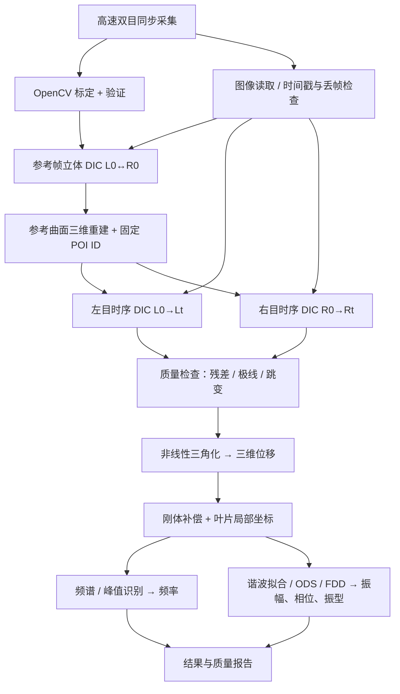
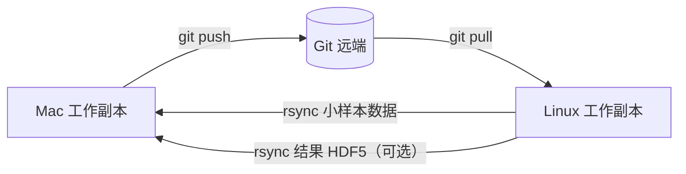
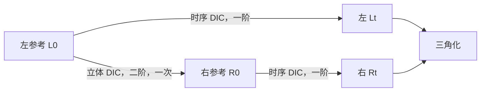

# StereoDIC：高速双目 DIC 叶片振动测量技术设计

> 文档版本：v0.2（工程实施版）  
> 项目名称：StereoDIC（仓库 `HS-3D-DIC`，Python 包名 `stereodic`）  
> 定位：面向工程交付的高精度三维全场光学振动测量，不以论文发表为目标  
> 适用对象：表面带随机散斑的复杂曲面薄壁叶片；第一阶段只针对固定夹持、不旋转的叶片  
> 上一版本：[archive/StereoDIC_Technical_Design_v0.1.md](archive/StereoDIC_Technical_Design_v0.1.md)

## 目录

0. [v0.2 变更说明](#0-v02-变更说明)
1. [项目目标与设计原则](#1-项目目标与设计原则)
2. [总体技术路线与试验流程](#2-总体技术路线与试验流程)
3. [实验系统与标定](#3-实验系统与标定)
4. [开发与运行环境](#4-开发与运行环境)
5. [代码目录架构](#5-代码目录架构)
6. [数据约定与数值精度](#6-数据约定与数值精度)
7. [核心 DIC 算法](#7-核心-dic-算法)
8. [计算后端与 GPU 加速](#8-计算后端与-gpu-加速)
9. [三维重建与位移](#9-三维重建与位移)
10. [质量控制与实测不确定度](#10-质量控制与实测不确定度)
11. [振动分析](#11-振动分析)
12. [数据存储与流水线](#12-数据存储与流水线)
13. [软件技术栈](#13-软件技术栈)
14. [验证方案](#14-验证方案)
15. [里程碑与验收](#15-里程碑与验收)
16. [风险与待确认参数](#16-风险与待确认参数)
17. [延后事项](#17-延后事项)
18. [参考资源](#18-参考资源)

## 0. v0.2 变更说明

| 方面 | v0.1 | v0.2 |
| --- | --- | --- |
| 目标定位 | 研究型框架，包含联合优化等扩展 | 工程交付：尽早拿到可验证的频率，再获得振幅、相位和振型 |
| 数值精度 | 全程 Float64 | CPU 参考后端全程 Float64；GPU 生产后端采用混合精度，但必须通过一致性测试（§6.3、§8） |
| 计算后端 | NumPy + Numba | 三后端：NumPy（参考）/ Numba CPU / CUDA（RTX A6000）；不使用 Apple MPS |
| 开发方式 | 未定义 | Mac 开发，Linux 运行，Git 同步代码，数据不进 Git（§4） |
| 标定 | 自研光束法平差 | 直接用 OpenCV 标定，靠位移台实验验证 |
| 不确定度 | 雅可比协方差传播和蒙特卡洛 | 以静态噪声底实测为准（§10.2） |
| 质量检查 | 包含四路径闭环 | 保留极线/重投影残差、抽样前后向检查和时间跳变检查 |
| 二阶形函数 | 视为待研究问题 | 直接采用 Gao 等 (2015) 的二阶 IC-GN 组合方法（M2 已实现，立体匹配默认） |
| 合成数据与基准 | S1–S8，B01–B09 | 合成数据 S1/S4/S6，基准 B01/B03，外加后端一致性测试 |
| 振动试验流程 | 只列算法 | 先宽带激励识别频率，再定频激励测振型；支持欠采样谐波拟合（§2.2、§11.3） |
| 精度指标 | 预设绝对数值 | 由最小关心振幅倒推（§15.2） |
| 代码规模 | 约 80 个文件 | 约 40 个文件；移除 `uncertainty/`、`validation/`、`dic/joint/` |
| V2/V3 联合优化、应变、IC-LM 等 | 列入 Phase 5 | 移入“延后事项”，只有基线精度不够时才重新评估（§17） |

## 1. 项目目标与设计原则

### 1.1 交付目标

用两台硬件同步的高速相机拍摄带散斑的叶片，通过 Stereo-DIC 得到以下结果：

1. **叶片三维形貌**：参考时刻共同可见区域的三维曲面和物质点坐标；
2. **三维振动位移场**：每个物质点逐帧的三维位移，以及叶片局部坐标系下的分量（弦向、展向、法向）；
3. **振动频率**：各阶共振频率（第一优先级交付物）；
4. **振幅、相位、ODS 和振型**：在定频激励下获得全场振幅、相位和工作变形振型；条件满足时给出阻尼比；
5. **质量信息**：有效测点掩膜、失败原因和实测噪声底。

双目系统只能测量两台相机共同看到的表面；叶片正反两面需要额外的相机或分次试验。

### 1.2 设计原则

1. **精度优先，范围克制。** 凡是影响精度的环节（插值、形函数、固定参考帧、非线性三角化、同步、标定验证）都按高标准实现；只服务于方法学研究的内容延后（§17）。
2. **先拿频率，再拿振型。** 频率识别对 DIC 精度要求最低，最先交付；振幅、相位和振型需要更多精度工作，随后交付。
3. **不使用深度学习。** 初值由 SIFT、ZNCC、FFT-CC 等传统方法提供。
4. **追踪物质点，不逐帧重建点云。** 所有帧共享稳定的 POI ID，不用最近邻或 ICP 推断位移。
5. **在原始灰度上匹配。** 最终 DIC 优化在原始（含畸变）图像上进行，不对整幅图像做几何重采样。
6. **固定参考帧。** 位移始终相对参考帧求解，前一帧只用作初值，避免误差累积。
7. **参考实现优先。** 每个计算核先有 FP64 的 NumPy 参考实现，加速版本（Numba、CUDA）必须通过与参考实现的一致性测试，才能用于生产。
8. **可追溯。** 每次运行记录 git commit、配置快照和输入文件指纹；原始测量与滤波、补偿、拟合结果分开保存。

## 2. 总体技术路线与试验流程

### 2.1 数据处理主链路



参考帧的立体匹配只做一次；之后左右目分别相对各自参考帧做时序追踪，再逐帧三角化。时序 DIC 是计算量的主体，由 GPU 后端承担（§8）。

### 2.2 试验流程

| 步骤 | 内容 | 目的 | 对应算法 |
| --- | --- | --- | --- |
| T0 | 检查散斑、对焦、曝光饱和度、两台相机同步（LED 或转盘） | 采集条件达标 | `quality`、`scripts/check_sync.py` |
| T1 | 标定板采集（20–40 个位姿） | 内外参 | `calibration` |
| T2 | 静止叶片连续采集（与正式试验相同的帧率和曝光） | 实测噪声底 E1 | `quality/noise_floor.py` |
| T3 | 位移台三方向平移（如果有位移台） | 三维尺度与方向耦合 E2 | `scripts/validate.py` |
| T4 | **宽带激励**：力锤、随机激励或正弦扫频 | **识别各阶频率** | 频谱、FDD |
| T5 | **定频激励**：在 T4 得到的每个共振频率上做正弦驻留 | 高精度振幅、相位和振型 | 谐波拟合、ODS |
| T6 | 同步采集加速度计/LDV 和激励信号 | 交叉验证 | `vibration/frf.py`、比对脚本 |

T4 要求帧率覆盖目标频率（不能欠采样）；T5 的频率已知，可以在帧率不足时利用欠采样（§11.3）。

## 3. 实验系统与标定

### 3.1 硬件

| 项目 | 要求 |
| --- | --- |
| 相机 | 两台同型号黑白高速相机，全局快门，保存原始位深 |
| 镜头 | 低畸变定焦镜头；焦距和工作距离由视场决定 |
| 双目夹角 | **建议 25°–35°**。叶片弯曲振动主要在法向，离面灵敏度随夹角增大而提高（§3.4）；上限受遮挡和散斑透视变形约束 |
| 同步 | 硬件 TTL 或主从触发；实测曝光中心的时间差 |
| 支架 | 刚性支架，与激振台、地面振源隔离 |
| 照明 | 高亮直流 LED（不能用交流供电，否则会出现频闪谱线），漫射；必要时用交叉偏振抑制金属反光 |
| 散斑 | 哑光薄底漆加随机黑点；成像直径 3–5 px，覆盖率 40%–60% |
| 激振 | 力锤（T4）、电磁或压电激振器（T4/T5） |
| 参考仪器 | 加速度计或 LDV；如有条件，加精密位移台和力传感器 |

散斑涂层会改变薄壁叶片的质量和阻尼，应尽量薄，必要时比较喷涂前后的频率。图像不做有损压缩，关闭自动增益和相机内降噪。

### 3.2 帧率与曝光

- **帧率**：宽带识别（T4）要求 $f_s > 2f_{max}$，工程上取 $f_s \ge 2.5f_{max}$；看清波形时取 $(5\sim10)f_{max}$。定频（T5）可以欠采样，见 §11.3。
- **频率分辨率**：$\Delta f = 1/T_{acq}$，与帧率无关，由采集时长决定。
- **曝光上限**：设物方振幅为 $A$（mm），物方比例为 $s$（mm/px），允许的运动模糊为 $\delta$（px）：

$$
t_{exp} \lesssim \frac{\delta\, s}{2\pi f A}.
$$

| 情形 | f | A | s | δ | 曝光上限 |
| --- | ---: | ---: | ---: | ---: | ---: |
| 低阶大振幅 | 500 Hz | 0.5 mm | 0.1 mm/px | 0.1 px | ≈ 6.4 µs |
| 高阶小振幅 | 3000 Hz | 0.02 mm | 0.1 mm/px | 0.1 px | ≈ 26.5 µs |

**照明通常是硬件瓶颈**，选灯前先用上式估算。

### 3.3 同步

两台相机的曝光时间差 $\Delta t$ 会带来约 $v\Delta t$ 的位置错配和 $2\pi f\Delta t$ 的相位误差。光检查帧率是否一致不够，必须实测：

- 在两台相机的视野中放同一个 LED，用微秒级脉冲驱动，比较两边亮起的帧号和亮度；或者
- 拍摄高速旋转、带刻线的转盘，比较两边的角度差。

保存每台相机的时间戳和帧号，用于丢帧检测（`io/sync.py`）。

### 3.4 精度的几何估算

对称会聚双目，夹角为 $\alpha$，两台相机的二维位移噪声均为 $\sigma_p$（px）：

$$
\sigma_{lat}\approx\frac{s\sigma_p}{\sqrt{2}\cos(\alpha/2)},\qquad
\sigma_{depth}\approx\frac{s\sigma_p}{\sqrt{2}\sin(\alpha/2)}.
$$

例：$s=0.1$ mm/px，$\sigma_p=0.01$ px，$\alpha=30°$，则 $\sigma_{lat}\approx0.73$ µm，$\sigma_{depth}\approx2.7$ µm（单帧）。

这只是设计阶段的量级估算，实际噪声以 E1 实测为准（§10.2）。

### 3.5 标定

- 标定板：圆点板或 ChArUco（局部遮挡时也能检测）。在实际测量体积内，以不同深度和倾角采集 20–40 组图像。
- 标定使用的分辨率、ROI、对焦、光圈和安装状态必须与正式采集**完全一致**；标定后不能再碰镜头。如果标定和采集的 ROI 不同，必须显式换算主点。
- 流程（OpenCV，已实现于 `calibration/`，入口 `scripts/calibrate.py`）：
  1. ChArUco：`CharucoDetector` 识别角点 ID，再在**原始位深**图像上用 `cornerSubPix` 精化棋盘格鞍点。精化窗口半宽取码与方格边之间白边宽度的 80%：窗口一旦碰到码的边缘，角点会偏 0.5–1 px（合成板 marker/square = 0.75 时实测）；
  2. 两台相机分别 `calibrateCamera`，剔除 RMS 超过中位数 3 倍的图像后重新标定；
  3. `stereoCalibrate`：先 `CALIB_FIX_INTRINSIC`，再加 `CALIB_USE_INTRINSIC_GUESS` 联合精化；
  4. 用最终参数重新计算每个点的残差（双目联合求板位姿），输出报告（JSON + 残差图）：每张图、每个点的重投影误差，以及基线长度和夹角。
- 畸变模型默认 $k_1,k_2,p_1,p_2$（固定 $k_3=0$），可选 $k_3$ 或有理模型。DIC 常用长焦镜头、视场窄，主点和高阶畸变本身就定不准（合成数据中 f=7500 px、视场 4° 时主点偏差可达 15 px），但这类偏差和外参相互抵消，对三维距离和位移几乎没有影响。所以**不要逐项比较内参，而要看三维量**。
- 合成验证（f = 2500 px，视场约 12°，12 个位姿，角点噪声约 0.03 px）：立体 RMS 0.035 px，焦距误差 0.01%，基线误差约 0.004 mm；测量体积内三维距离的相对误差 < 5e-4，0.1 mm 位移的误差 < 0.2 µm。
- 指标：重投影 RMS 小于 0.1 px 只用于诊断，**三维精度以 E2 位移台实验为准**。
- 如果导入 MATLAB 的标定结果：MATLAB 采用 1 基像素坐标，主点 $c_x,c_y$ 要各减 1；同时注意矩阵转置约定。

相机模型：

$$
\theta=\{K_L,D_L,K_R,D_R,R_{RL},t_{RL}\},\qquad X_R=R_{RL}X_L+t_{RL}.
$$

亚像素 DIC 在原始畸变图像上进行，只对匹配得到的点坐标做去畸变，或者在三角化中直接使用带畸变的投影模型。极线粗搜索可以在校正后的图像中进行，但精细匹配要回到原始坐标域。

## 4. 开发与运行环境

### 4.1 机器分工

| 机器 | 角色 | 计算后端 |
| --- | --- | --- |
| Mac（Apple Silicon） | 写代码、单元测试、小数据调试、结果可视化 | `numpy` / `numba` |
| Linux + RTX A6000 | 处理完整数据集、跑 CUDA 后端和 GPU 测试 | `numba` / `cuda` |

Apple MPS 不支持 float64，而且 DIC 需要自定义计算核，所以不用 MPS。

### 4.2 Git 工作流



- 远端：可以是私有 GitHub/GitLab 仓库，也可以是 Linux 上的裸仓库（`git init --bare`，Mac 通过 SSH 推送）。
- 原则上**只在 Mac 上改代码**；Linux 上只 `git pull`。如果必须在 Linux 上热修，也要提交并推送，不能留未提交的改动。
- 分支：`main` 保持可运行；功能开发在 `feat/*` 分支，测试通过后再合并。
- 生产运行时把 `git rev-parse HEAD` 写进 HDF5 元数据；工作区不干净时给出警告（可配置成直接拒绝运行）。

### 4.3 数据与路径

- **数据不进 Git**：原始图像、HDF5 和结果都放在各机器的数据目录中。
- 与机器相关的路径写在 `configs/local.yaml`（列入 `.gitignore`）；仓库只提交 `configs/local.yaml.example`。也可以用环境变量 `STEREODIC_DATA_ROOT` 指定。
- `scripts/make_dev_subset.py`：在 Linux 上从完整数据中截取一部分（例如 200 帧、局部 ROI），连同裁剪后的标定一起打包，再 rsync 到 Mac 调试。
- 少量用于测试的微型数据（小于几 MB）可以放在 `tests/data/` 并纳入 Git。

### 4.4 Python 环境

- Python 3.12，使用 **uv** 管理依赖，`uv.lock` 跨平台锁定版本，保证两台机器一致。
- CUDA 依赖作为可选组：`uv sync --extra cuda`（`cupy-cuda12x`），只在 Linux 上安装。
- pytest 标记：`@pytest.mark.cuda` 的测试在没有 GPU 的机器上自动跳过；`@pytest.mark.slow` 默认不跑。
- 长时间任务在 Linux 上用 `tmux` 运行；流水线支持断点续算（§12）。

`.gitignore` 至少包含：

```text
.venv/
__pycache__/
.DS_Store
.ipynb_checkpoints/
configs/local.yaml
data/
results/
*.h5
*.hdf5
*.cine
*.mraw
```

## 5. 代码目录架构

```text
HS-3D-DIC/
├── pyproject.toml
├── uv.lock
├── README.md
├── .gitignore
├── configs/
│   ├── defaults/                 # dic.yaml、vibration.yaml 等默认参数（入库）
│   ├── experiments/              # 每次试验一个 yaml（入库）
│   └── local.yaml.example        # 机器相关路径模板
├── stereodic/
│   ├── core/
│   │   ├── types.py              # CameraModel、StereoCalibration、POISet、批量结果等
│   │   ├── config.py             # Pydantic 配置模型 + YAML 加载与合并
│   │   └── status.py             # 状态码枚举
│   ├── io/
│   │   ├── readers/              # tiff.py；按实际相机补 cine.py / mraw.py
│   │   ├── sequence.py           # 懒加载、ROI、多线程预读
│   │   ├── sync.py               # 时间戳配对、丢帧检测
│   │   └── storage.py            # HDF5 读写、进度标记、配置哈希
│   ├── calibration/
│   │   ├── detect.py             # 棋盘格 / 圆点 / ChArUco 检测
│   │   ├── calibrate.py          # 单目 + 双目标定（OpenCV）
│   │   ├── camera_model.py       # 投影、去畸变、雅可比
│   │   └── report.py             # 重投影误差统计和图
│   ├── dic/
│   │   ├── mesh.py               # ROI 掩膜、POI 网格、邻接关系
│   │   ├── interp.py             # B 样条预滤波、取值与梯度（参考实现）
│   │   ├── shape_functions.py    # 0/1/2 阶形函数：warp、jacobian、compose、inverse
│   │   ├── icgn.py               # ZNSSD + IC-GN 参考实现（NumPy，FP64）
│   │   ├── init_guess.py         # FFT-CC、ZNCC 极线搜索、SIFT + 仿射
│   │   ├── rgdic.py              # 可靠性引导传播
│   │   ├── stereo_match.py       # L0↔R0
│   │   ├── temporal.py           # L0→Lt、R0→Rt 调度（按帧顺序、POI 并行）
│   │   └── backends/
│   │       ├── __init__.py       # 后端选择：numpy | numba | cuda | auto
│   │       ├── numba_cpu.py      # Numba 并行 IC-GN
│   │       └── cuda/
│   │           ├── runner.py     # CuPy 数据管理、批处理、流水线
│   │           └── icgn.cu       # IC-GN CUDA 核（RawModule 加载）
│   ├── recon/
│   │   ├── triangulate.py        # DLT + 非线性三角化（唯一实现）
│   │   ├── frames.py             # 法向与叶片局部坐标系
│   │   ├── shape.py              # 参考形貌：三角化 + 几何检查 + 法向 / 局部坐标系 / 网格
│   │   └── rbm.py                # 刚体运动估计与补偿
│   ├── quality/
│   │   ├── checks.py             # 状态码、残差阈值、极线 / 重投影、时间跳变、前后向抽检
│   │   ├── image.py              # 饱和、散斑尺寸、对比度
│   │   └── noise_floor.py        # 由静态数据得到逐点噪声底
│   ├── uncertainty/
│   │   ├── propagation.py       # 三角化和位移协方差传播
│   │   └── monte_carlo.py       # 像素观测蒙特卡洛校验
│   ├── vibration/
│   │   ├── spectrum.py           # FFT / Welch / 峰值插值 / 平均谱
│   │   ├── harmonic.py           # 基于时间戳的谐波拟合（支持欠采样）
│   │   ├── ods.py                # 工作变形振型
│   │   ├── fdd.py                # 频域分解
│   │   ├── frf.py                # H1 FRF + 相干函数（有力信号时）
│   │   ├── damping.py            # 半功率带宽、自由衰减拟合
│   │   └── mac.py
│   ├── synth/
│   │   ├── speckle.py            # 连续散斑纹理
│   │   ├── render.py             # 高斯–勒让德像素积分；斑点渲染与逐点反映射渲染
│   │   ├── stereo.py             # 双目场景：相机、高度场曲面、刚体运动、真值
│   │   └── charuco.py            # 合成 ChArUco 标定图像
│   ├── viz/
│   │   ├── plots.py              # 云图、频谱、误差统计
│   │   └── animate.py            # PyVista 振型 / ODS 动画
│   └── pipeline.py               # 分阶段编排、缓存、断点续算
├── scripts/
│   ├── calibrate.py
│   ├── run_dic.py                # --stage stereo | temporal | reconstruct
│   ├── analyze.py
│   ├── validate.py               # E1/E2/对比 LDV 的报告
│   ├── check_sync.py
│   └── make_dev_subset.py
├── tests/
│   ├── data/                     # 微型测试数据
│   ├── unit/
│   ├── integration/
│   └── backends/                 # 后端一致性测试（cuda 标记）
├── benchmarks/                   # B01、B03、后端性能
├── notebooks/                    # 探索用，核心算法不写在这里
└── docs/
```

### 5.1 模块边界

| 模块 | 输入 | 输出与职责 |
| --- | --- | --- |
| `core` | — | 公共类型、配置、状态码，不依赖任何业务模块 |
| `io` | 原始文件 | 同步帧对、时间戳、HDF5 存储 |
| `calibration` | 标定图像 | `StereoCalibration` 与报告 |
| `dic` | 图像、POI、相机模型（仅立体匹配） | 二维对应、残差、状态码 |
| `recon` | 相机模型、二维对应 | 三维坐标、位移、局部坐标 |
| `quality` | 诊断数据 | 有效掩膜、失败原因、噪声底 |
| `vibration` | 位移、时间戳、可选力信号 | 频率、振幅、相位、振型 |
| `synth` | 独立渲染模型 | 合成图像与真值（不依赖 `dic`） |
| `pipeline` | 配置 | 编排、缓存、续算 |

- 三角化只在 `recon/triangulate.py` 中实现一次。
- `quality` 只读诊断数据，不反向调用求解器。
- 后端只实现计算核，调度逻辑（帧顺序、初值、失败重试）在 `temporal.py` 中，各后端共用。

## 6. 数据约定与数值精度

### 6.1 全局约定

| 项目 | 约定 |
| --- | --- |
| 图像坐标 | $(x,y)$，向右、向下为正，零基，整数位于像素中心（与 OpenCV 一致） |
| NumPy 索引 | `image[y, x]` |
| ROI | 显式保存 ROI 原点；所有坐标统一换算到标定所用的全幅坐标 |
| 三维坐标 | 默认左相机坐标系，右手系；叶片局部坐标单独保存 |
| 双目外参 | `X_right = R_RL @ X_left + t_RL` |
| 单位 | 长度 mm（报告中可换成 µm），时间 s，频率 Hz，相位 rad |
| 数组轴 | 时序 `(T, N, C)`，参考 `(N, C)` |
| 位移 | `X_t - X_0`，不做逐帧增量累加 |
| 无效值 | NaN + 有效掩膜 + 状态码 |
| POI | 稳定的 `point_id`，失配时不删除、不重排 |

### 6.2 状态码（`core/status.py`，uint8）

| 码 | 名称 | 含义 |
| ---: | --- | --- |
| 0 | `NOT_COMPUTED` | 尚未计算 |
| 1 | `OK` | 收敛并通过检查 |
| 2 | `OUT_OF_BOUNDS` | 子区越出图像或 ROI |
| 3 | `LOW_TEXTURE` | 灰度方差或 SSSIG 过低 |
| 4 | `ILL_CONDITIONED` | 参考 Hessian 病态 |
| 5 | `NOT_CONVERGED` | 达到最大迭代次数仍未收敛 |
| 6 | `HIGH_RESIDUAL` | ZNSSD 超过阈值 |
| 7 | `GEOMETRY_INCONSISTENT` | 极线 / 重投影残差超限 |
| 8 | `TEMPORAL_JUMP` | 相邻帧位移跳变异常 |
| 9 | `MASKED` | 被遮挡或位于人工掩膜区 |

收敛不等于有效。

### 6.3 数值精度策略

| 数据 | NumPy 参考后端 | Numba CPU | CUDA |
| --- | --- | --- | --- |
| 形函数参数、POI 中心坐标、迭代更新 | FP64 | FP64 | FP64 |
| 插值位置：整数索引 + 小数部分 | FP64 | FP64 | FP64 拆分后，小数部分转成 FP32 |
| B 样条系数、灰度采样、残差、梯度 | FP64 | FP64 | FP32 |
| Hessian、$J^Tr$ 累加、均值与范数 | FP64 | FP64 | FP64 |
| 三角化、三维几何、振动分析 | FP64 | — | —（在 CPU 上算） |

依据：子区中心的绝对坐标可达约 2000 px，FP32 在这个量级的分辨率只有约 1e-4 px，所以中心坐标和参数必须用 FP64。插值的小数部分在 [0,1) 区间内，FP32 精度约 1e-7 px。12 位灰度在 FP32 下的舍入误差远小于传感器噪声。

**规则：任何非 FP64 的后端，在合成数据和真实数据的子集上，都必须满足与 FP64 参考结果的位移差 P99 < 1e-4 px，才能用于生产。** 一致性测试放在 `tests/backends/`。所有后端关闭 `fastmath`（CUDA 编译时不加 `--use_fast_math`）。

## 7. 核心 DIC 算法

### 7.1 POI、子区与相关准则

- 在左参考帧 $L_0$ 的 ROI 掩膜内布置 POI 网格。初始参数：子区 31×31 px，步长 5 px；用 B03 比较 21–51 px 的子区。
- 子区跨越叶缘：目前 POI 网格只保留整个子区都落在掩膜内的点（`poi_mask`），叶缘留下约半个子区宽的空带。只用掩膜内有效像素的部分子区（加权 ZNSSD）推迟到实测数据确认需要时再做。
- 相关准则：ZNSSD

$$
C(p)=\sum_{q\in\Omega}\left[\frac{f_q-\bar f}{\Delta f}-\frac{g_q(p)-\bar g}{\Delta g}\right]^2,\quad
\Delta f=\sqrt{\textstyle\sum_q(f_q-\bar f)^2}.
$$

- ZNCC 只用于初值搜索。灰度方差过低的子区直接拒绝计算（`LOW_TEXTURE`）。

### 7.2 插值

- 默认使用**五次 B 样条**，三次作为配置开关。依据是 B01：D=4 px 散斑、无噪声时，最大偏差五次为 0.00045 px、三次为 0.0018 px；吞吐五次约为三次的 0.7 倍。双线性只用于测试对照。
- 每帧预计算一次样条系数：

```python
from scipy.ndimage import spline_filter, map_coordinates
coeff = spline_filter(image.astype(np.float64), order=3, mode="mirror")
vals = map_coordinates(coeff, [y, x], order=3, mode="mirror", prefilter=False)
```

- 统一接口：`prepare(image)`、`evaluate(x, y)`、`gradient(x, y)`。梯度由样条基函数的解析导数计算，单元测试与数值差分对照。
- **边界安全带**：镜像边界条件并不是真实场景的延续，靠近图像边缘几个像素内的插值明显不准。合成数据实测：三次样条约 4 px、五次约 7 px 以内误差偏大。因此可靠域取 $[b, W-1-b]\times[b, H-1-b]$，其中 $b$ = 5（三次）/ 8（五次）（`interp.BORDER`）；子区一旦进入安全带就报 `OUT_OF_BOUNDS`。实际试验中 ROI 一般远离图像边缘，这条规则主要防止错误的边缘测点混入。
- **参考子区也通过插值采样**，即使中心落在整数像素上。这样左目（整数网格）和右目（立体匹配得到的非整数中心）走同一条代码路径，不会因四舍五入造成物质点错位。

### 7.3 形函数

采用以子区中心为原点的局部坐标 $(\Delta x,\Delta y)$。

| 阶数 | 参数数 | 用途 |
| --- | ---: | --- |
| 0（平移） | 2 | 插值和亚像素偏差测试 |
| 1（仿射） | 6 | **时序匹配默认** |
| 2（二次） | 12 | **立体匹配默认**（透视变形和曲面） |

一阶：$x'=x+u+u_x\Delta x+u_y\Delta y$，$y'=y+v+v_x\Delta x+v_y\Delta y$，用 3×3 齐次矩阵精确实现组合与求逆。

二阶：采用 Gao 等 (2015) 的方法，把二阶形函数提升为作用在二次单项式向量 $(\Delta x^2,\Delta x\Delta y,\Delta y^2,\Delta x,\Delta y,1)$ 上的 6×6 矩阵，在这个空间中实现 IC-GN 的组合与求逆。$x'^2$ 等行截断到二阶，这只影响收敛路径，不改变不动点。参数顺序 $(u,u_x,u_y,u_{xx},u_{xy},u_{yy},v,\dots)$，二阶项带 1/2 系数。已通过 S1（二次位移场）和 S4：二次位移场中一阶 RMSE 0.024 px、二阶 0.0006 px；双目匹配中一阶 0.011 px、二阶 0.001 px（B04）。因此立体匹配默认二阶。

接口：`warp`、`jacobian`、`compose`、`inverse`。IC-GN 更新为 $W(p)\leftarrow W(p)\circ W(\Delta p)^{-1}$，**不能**写成 `p -= dp`。

### 7.4 IC-GN 求解器

IC-GN 的关键特性：Hessian 只依赖参考子区，每个 POI 只需计算并求逆**一次**。迭代中每一步只需要采样目标图像、计算残差和累加 $J^Tr$。

```python
ref = solver.prepare_reference(ref_coeff, center_xy, subset)   # 一次：f、∇f、J、H⁻¹
res = solver.solve(ref, target_coeff, p0)                      # 每帧：迭代更新
```

ZNSSD 版本的增量（Pan 等, 2013）：

$$
\Delta p=-H^{-1}\sum_q J_q^T\left[(f_q-\bar f)-\frac{\Delta f}{\Delta g}(g_q-\bar g)\right].
$$

| 参数 | 默认值 |
| --- | --- |
| 最大迭代次数 | 50 |
| 收敛判据 | 子区角点位移增量的最大值 < 1e-3 px（B01 中做敏感性测试） |
| Hessian 求逆 | 参考阶段用 Cholesky；条件数超过阈值时标记 `ILL_CONDITIONED` |
| 失败处理 | 写入状态码，不输出伪测量值 |

### 7.5 初值与 RG-DIC

| 场景 | 初值 |
| --- | --- |
| 时序匹配 | 上一帧的解；失败时用邻点的解，再失败就在局部做 FFT-CC 重新搜索 |
| 立体匹配种子点 | SIFT（8 位拉伸副本）+ 比值检验 + 极线约束剔除外点（有标定用标定的基础矩阵，否则 RANSAC），每个种子 POI 用半径 40 px 内的匹配做 RANSAC 局部仿射 |
| 立体匹配其余点 | RG-DIC：按 ZNSSD 从低到高用优先队列传播，以邻点的形函数平移到本点中心（多项式平移是精确的）作为初值 |

RG-DIC 只用于提供初值；每个点仍然独立做 IC-GN。只在 4 邻域内传播，网格中的空缺（掩膜外）自然隔断传播；传播不到的区域用本区域的 SIFT 种子重新起步。失败的点可以从别的已解邻点再试，次数不超过邻点数。沿极线 ZNCC 搜索暂未实现，SIFT 在实测散斑上失效时再补。

### 7.6 立体匹配与时序匹配



1. `stereo_match.py`：得到 $p^0_{L,i}\leftrightarrow p^0_{R,i}$，并保存 ZNSSD、状态码和 POI ID。
2. `temporal.py`：每台相机独立计算 $p^t_{c,i}=p^0_{c,i}+\Delta p^t_{c,i}$，始终相对参考帧。
3. 调度方式：**帧按顺序处理，同一帧内所有 POI 并行**。这样可以用上一帧的解作初值，同时每帧上万个 POI 足以让 GPU 满载。
4. 参考帧要选在运动模糊最小的时刻（例如激振前的静止帧）。

## 8. 计算后端与 GPU 加速

### 8.1 后端划分

| 后端 | 平台 | 用途 |
| --- | --- | --- |
| `numpy` | 所有平台 | FP64 参考实现，可读性优先，用作正确性基准 |
| `numba` | Mac、Linux | CPU 多核生产后端（`parallel=True`），FP64 |
| `cuda` | Linux + A6000 | 时序 DIC 主力后端，混合精度（§6.3） |

在配置中通过 `dic.backend: auto | numpy | numba | cuda` 选择；`auto` 能找到 CuPy 和 GPU 时用 `cuda`，否则用 `numba`。

### 8.2 GPU 的使用范围

| 环节 | 运行位置 | 说明 |
| --- | --- | --- |
| 时序 DIC | **GPU** | 计算量的主体（POI 数 × 帧数 × 2 台相机，约 1e8–1e9 次求解） |
| 逐帧 B 样条预滤波 | **GPU** | `cupyx.scipy.ndimage.spline_filter` |
| 参考帧立体匹配 | CPU | 只算一次，RG-DIC 逻辑复杂 |
| 标定、三角化、振动分析 | CPU | 计算量小 |

### 8.3 CUDA 核设计

- 用 CuPy 管理显存和数据传输；IC-GN 写成 CUDA C 核（`icgn.cu`），通过 `cupy.RawModule` 加载。
- **每个 POI 分配一个线程块**（例如 256 线程），块内线程分摊子区像素：
  1. 每个线程按当前形函数计算变形后的位置，从样条系数中插值（三次样条 4×4、五次 6×6 个系数）；
  2. 块内归约（FP64）求 $\bar g$、$\Delta g$；
  3. 每个线程计算残差与 $J_q$ 的乘积，块内归约得到 6 维（二阶为 12 维）$J^Tr$；
  4. 0 号线程用预存的 $H^{-1}$ 求 $\Delta p$，做 warp 的组合，判断是否收敛。
- 参考数据（归一化后的 $f$、最速下降图像 $J$、$H^{-1}$）在参考阶段预计算并常驻显存。显存估算：31×31 子区、一阶形函数（$f$ 加 6 张最速下降图像）、FP32 存储时每个 POI 约 27 KB，2 万个 POI 约 0.55 GB。
- 数据流水线：多线程读盘 → 锁页内存 → 异步拷贝 → GPU 预滤波 → IC-GN。用 CUDA stream 让读盘、拷贝和计算重叠。48 GB 显存可以缓存上千帧的样条系数。
- **瓶颈预计在读盘**（数据集动辄几十 GB），应把原始数据放在本地 NVMe 上。

### 8.4 性能预估（待 M3 实测）

| 后端 | 粗略量级 |
| --- | --- |
| `numpy` | 只用于小规模测试 |
| `numba`（16 核） | 2 万 POI × 1 万帧 × 2 台相机：约几十分钟到数小时 |
| `cuda`（A6000） | 同上：预计为 `numba` 的数倍到一个数量级；实际多半受限于读盘 |

以上是估算，不作为指标，最终以 `benchmarks/` 的实测为准。

## 9. 三维重建与位移

### 9.1 三角化

1. 对二维观测去畸变，用线性 DLT 得到初值；
2. 在原始像素域最小化重投影误差（每个点只有 3 个未知量，可以向量化 Gauss-Newton 批量求解）：

$$
X_i^t=\arg\min_X\sum_{c\in\{L,R\}}\left\|\pi_c(X;\theta)-p^t_{c,i}\right\|^2.
$$

3. 检查深度为正、三角化夹角和重投影残差；残差超限时标记 `GEOMETRY_INCONSISTENT`。这一步同时承担逐帧的极线一致性检查，几乎不增加计算量。
4. 位移 $U^t_i=X^t_i-X^0_i$。不做逐帧 ICP；网格沿用参考拓扑，只更新顶点坐标。

### 9.2 叶片局部坐标系

在参考曲面上，用邻域 PCA 或局部二次曲面拟合求法向 $n_i$，并统一法向朝向（朝向相机一侧）。把叶展参考方向投影到切平面并归一化得到 $s_i$，再令 $c_i=s_i\times n_i$，构成右手系 $(c_i,s_i,n_i)$。局部坐标系在参考时刻定义后固定不变：

$$
U^t_{local,i}=[c_i\;s_i\;n_i]^TU^t_i.
$$

### 9.3 刚体运动补偿

- 在叶根夹具上（或在独立的固定背景上）布置散斑参考区，用加权 Kabsch/SVD 估计 $X^t_{ref}\approx R_tX^0_{ref}+t_t$；
- 相对位移：$U^t_{rel,i}=R_t^T(X^t_i-t_t)-X^0_i$；
- 夹具参考区给出的是“相对叶根的弹性振动”，固定背景给出的是“相机系统的整体晃动”。原始位移和补偿后的位移都保存。

## 10. 质量控制与实测不确定度

### 10.1 质量检查

| 检查 | 时机 | 开销 |
| --- | --- | --- |
| 图像饱和、散斑尺寸和对比度 | 采集后（T0） | 低 |
| 子区纹理（灰度方差 / SSSIG）、参考 Hessian 条件数 | 参考阶段，一次 | 低 |
| ZNSSD 阈值、迭代次数 | 每帧每点 | 无额外开销 |
| 重投影 / 极线残差 | 三角化时 | 很低 |
| 时间跳变：$\lvert\Delta u_t-\Delta u_{t-1}\rvert$ 的稳健离群检测 | 后处理 | 低 |
| 前后向抽检（Lt→L0 独立匹配） | 每隔 `fb_stride` 帧抽检 | 可配置 |
| 有效 POI 比例、缺测时间比例 | 汇总 | 低 |

阈值（ZNSSD、残差、跳变）由 E1 静态数据的统计分布确定，不凭经验拍定。无效点保留 ID 和失败原因；后续插补得到的数据单独保存，并附带掩膜。

### 10.2 实测不确定度

以 **E1 静态噪声底**作为工程上的不确定度：

1. 叶片静止时，用与正式试验相同的帧率、曝光和照明连续采集，并完整走一遍流水线；
2. 每个 POI、局部坐标的每个方向得到噪声标准差 $\sigma_{n,i}$，同时计算噪声谱（检查是否存在照明频闪、环境振动等谱线）；
3. 结果存为 `quality/noise_floor`，用于：
   - 设置振幅检测门限（例如振幅超过 $5\sigma$ 才认为显著）；
   - 估算谐波拟合后的振幅不确定度（§11.3）；
   - 检验 §3.4 的几何估算是否成立。

E1 不能覆盖标定尺度误差和动态误差（模糊、同步），这两项分别由 E2（位移台）和对比 LDV/加速度计覆盖。

## 11. 振动分析

### 11.1 预处理

- 检查时间戳：存在丢帧时，FFT/Welch 只用连续的数据段，或改用直接基于时间戳的谐波拟合；不能把时间轴压缩来掩盖丢帧。
- 去均值或去线性趋势；无效点不参与分析（NaN 掩膜）。
- 默认分析局部法向分量 $U_n$，三个分量都保留。

### 11.2 频率识别（宽带激励 T4）

1. 每个有效点算 $U_n$ 的 Welch PSD（Hann 窗），再求全场平均 PSD；或者用 FDD 的第一奇异值谱（§11.5）。平均可以把孤立的噪声峰压下去。
2. 选峰：设定显著性阈值并剔除已知干扰频率（照明、电源 50/100 Hz 等）。
3. 峰频精化：对对数幅值做抛物线插值，或补零加密，得到亚分辨率的频率估计。
4. 输出各阶频率、峰值信噪比和半功率带宽（粗估阻尼）。

单边幅值谱要正确处理窗函数的相干增益、DC 和 Nyquist 分量；PSD 和幅值谱的单位不能混用。

### 11.3 谐波拟合（定频激励 T5）

对每个点、每个方向，按实际时间戳 $t_k$ 做最小二乘：

$$
u(t_k)=a\cos(\omega t_k)+b\sin(\omega t_k)+c\;(+\,d\,t_k),\qquad
A=\sqrt{a^2+b^2},\quad\varphi=\operatorname{atan2}(-b,a),
$$

对应 $u=A\cos(\omega t+\varphi)$。可以加入高次谐波项，用来检查非线性。

- **频率来源**：激振信号（推荐与图像同步采集），或 §11.2 识别出的峰频。若频率误差为 $\delta f$，采集时长 $T$ 内会累积 $2\pi\,\delta f\,T$ 的相位漂移，所以要么频率足够准，要么把全局 $\omega$ 作为一个非线性参数，用全场数据一起拟合。
- **欠采样**：当 $f>f_s/2$ 时，只要 $\omega$ 已知，并且混叠后的频率不靠近 0 或 $f_s/2$，振幅和相位仍然可以恢复。混叠到负频率时，相位符号需要按混叠关系修正，代码中统一处理。这样在相机帧率不够时也能测量高阶振型。欠采样不能放宽曝光要求（§3.2）。
- **不确定度**：噪声为白噪声时，$\sigma_A\approx\sqrt{2/N}\,\sigma_n$。固定参考帧带来的相关误差不随 $N$ 下降，所以实际值应以 E1 数据上做同样拟合的结果为准。

### 11.4 ODS

在目标频率处取所有 POI 的复数响应 $a-ib$，以参考点或激励信号的相位为基准，构成全场 ODS，并用三维动画显示（`viz/animate.py`）。定频激励且模态间隔良好时，ODS 近似等于该阶振型。

### 11.5 FDD

当 POI 数量很多时，不构建 $3N\times3N$ 的互谱矩阵。把每个频率上 Welch 各分段的频域数据组成 $Y_f$（通道数 × 分段数），对其做薄 SVD，第一奇异值随频率的曲线用于识峰，对应的奇异向量即振型。

### 11.6 FRF、阻尼与 MAC

- 有同步的力信号时：$H_1(f)=G_{uF}/G_{FF}$，同时计算相干函数。
- 阻尼：用半功率带宽法（宽带激励），或者对锤击后自由衰减段的谐波包络做指数拟合。
- MAC 用于与 FEM 振型或重复试验比对：

$$
MAC(\phi_1,\phi_2)=\frac{|\phi_1^H\phi_2|^2}{(\phi_1^H\phi_1)(\phi_2^H\phi_2)}.
$$

比对前要统一坐标系、点集和分量。

## 12. 数据存储与流水线

### 12.1 HDF5 schema v1

`T` 为帧数，`N` 为 POI 数。参考帧的索引记录在 `reference/frame_index` 中。

```text
experiment_xxx.h5
├── metadata/            schema_version, git_commit, git_dirty, config_snapshot,
│                        input_manifest(路径/大小/指纹/相机/曝光/ROI), units, conventions
├── calibration/         K_left, D_left, K_right, D_right, R_RL, t_RL, image_size, roi_origin
├── reference/
│   ├── frame_index
│   ├── point_ids        (N,)      int64
│   ├── points_left      (N,2)     float64
│   ├── points_right     (N,2)     float64
│   ├── points_left_image / points_right_image (N,2)  # 图像坐标（未加 sensor_origin）
│   ├── points_3d        (N,3)     float64
│   ├── normals          (N,3)     float64
│   ├── local_frames     (N,3,3)   float64   # 行向量 (c, s, n)
│   ├── connectivity     (M,3)     int64   # 三角网格
│   ├── stereo_znssd     (N,)      float32
│   ├── stereo_params    (N,12)    float64   # L0 -> R0 二阶形函数
│   ├── reprojection_error (N,)    float32
│   └── stereo_status    (N,)      uint8
├── time/                timestamps (T,), timestamps_left (T,), timestamps_right (T,), frame_ids (T,2)
├── dic/left|right/
│   ├── xy               (T,N,2)   float64
│   ├── znssd            (T,N)     float32
│   ├── iterations       (T,N)     uint8
│   └── status           (T,N)     uint8
├── reconstruction/
│   ├── displacement_raw   (T,N,3) float64
│   ├── displacement_rbm   (T,N,3) float64   # 可选
│   ├── displacement_local (T,N,3) float64
│   ├── rbm_R (T,3,3), rbm_t (T,3)
│   └── reprojection_error (T,N)   float32
├── quality/             valid_mask (T,N) bool, noise_floor (N,3), thresholds
├── vibration/           peaks/(frequencies, snr, bandwidth),
│                        harmonic/<f>/(amplitude (N,3), phase (N,3), residual (N,3)),
│                        fdd/(freqs, singular_values, mode_shapes (M,N,3) complex)
└── progress/            stage_done 标记, stage_config_hash, dic_frames_done (T,2)
```

- 默认**不保存**逐点形函数参数和协方差（2 万点 × 1 万帧 × 6 个参数 × 8 字节，单台相机就约 9.6 GB）。调试时可以通过 `storage.save_params: true` 打开。
- 数据量参考：xy 每台相机约 3.2 GB，位移约 4.8 GB（2 万点 × 1 万帧）。
- chunk 兼顾按帧写入和按点读时间序列，初始取 `(64, 2048, C)`，用 LZF 无损压缩。

### 12.2 流水线与缓存

- 阶段：`calibrate` → `stereo` → `temporal` → `reconstruct` → `analyze`。每个阶段记录配置哈希和上游签名；依赖没有变化时直接复用结果。
- 修改 DIC 参数，`temporal` 及其下游失效；修改标定，`stereo` 及其下游失效；只修改频谱参数时只重算 `analyze`。
- `temporal` 以帧块为单位写入并 flush，然后更新 `dic_frames_done`，中断后可从断点续算。
- 单进程写 HDF5，计算由多线程或 GPU 承担。

### 12.3 配置示例

```yaml
# configs/defaults/dic.yaml
backend: auto            # auto | numpy | numba | cuda
poi:
  subset_size: 31
  step: 5
interpolation:
  order: 5               # 3 | 5
solver:
  max_iterations: 50
  convergence_threshold_px: 0.001
stereo:
  shape_order: 2         # 二阶 IC-GN 通过测试前设为 1
  initialization: sift_affine   # sift_affine | epipolar_zncc
  reliability_guided: true
temporal:
  shape_order: 1
  initialization: previous_solution
  frame_batch: 64
quality:
  fb_stride: 50          # 每 50 帧抽检一次前后向
storage:
  save_params: false
```

```yaml
# configs/local.yaml（不入库）
data_root: /data/hs3ddic
results_root: /data/hs3ddic/results
```

### 12.4 命令行（拟定）

```bash
uv run python scripts/calibrate.py --config configs/experiments/exp001.yaml
uv run python scripts/run_dic.py   --config configs/experiments/exp001.yaml --stage stereo
uv run python scripts/run_dic.py   --config configs/experiments/exp001.yaml --stage temporal --resume
uv run python scripts/run_dic.py   --config configs/experiments/exp001.yaml --stage reconstruct
uv run python scripts/analyze.py   --config configs/experiments/exp001.yaml
```

脚本只负责解析参数和调用库函数；核心算法不写在脚本或 notebook 里。

## 13. 软件技术栈

| 依赖 | 用途 | 平台 |
| --- | --- | --- |
| Python 3.12 + uv | 运行环境与依赖锁定 | 两台机器 |
| NumPy / SciPy | 数组、B 样条、信号处理 | 两台机器 |
| OpenCV (`opencv-python-headless`) | 标定、SIFT、ChArUco（4.7+ 已并入主模块） | 两台机器 |
| Numba | CPU 并行计算核 | 两台机器 |
| CuPy (`cupy-cuda12x`) | GPU 数组、预滤波、RawModule | 仅 Linux（`--extra cuda`） |
| h5py | HDF5 | 两台机器 |
| tifffile | 高位深 TIFF | 两台机器 |
| Pydantic + PyYAML | 配置 | 两台机器 |
| PyVista | 三维云图和振型动画 | 主要在 Mac |
| Matplotlib | 图表 | 两台机器 |
| pytest | 测试 | 两台机器 |

CINE/MRAW 等相机原生格式的读取器在确定相机型号后再写，需要验证位深打包方式、时间戳和帧号。也可以先在相机软件中导出 16 位 TIFF。

## 14. 验证方案

### 14.1 合成数据

合成器（`synth/`）用解析高斯斑点纹理生成图像，再加入噪声和量化，**不使用 DIC 求解器中的 B 样条插值**，以免“用同一个模型自证”。

- 像素积分采用 Gauss–Legendre 求积，而不是中点过采样。被积函数光滑，所以收敛是谱收敛的：6×6 个点时误差约 2e-8，8×8 时约 6e-11（相对于满量程）；中点规则在同样点数下误差约 5e-3，会带来约 0.01 px 的假误差。
- 变形通过移动斑点中心并变换协方差（$\Sigma\to J\Sigma J^T$）实现：仿射变形是精确的，一般变形是二阶近似。渲染严格满足平移等变性（整数平移的结果与平移前一致到 1e-12）。
- 小散斑（D≈4 px）加上饱和的透射率模型会产生混叠，B 样条无法完全重建。这和真实相机的情况一致，所以 B01 同时报告 D=4 和 D=6 的结果。
- 非仿射映射（曲率、透视、镜头畸变）用**逐点反映射渲染**（`render_pointwise` / `render_function`）：每个求积节点沿 像素 → 去畸变射线 → 曲面求交 → 纹理坐标 求出材料点，再精确计算纹理。斑点局部仿射近似在二次位移场中会带来约 0.002 px 的假误差，逐点渲染没有这一项。
- 双目场景（`synth/stereo.py`）：世界系 = 左相机，高度场曲面（平面、圆柱）+ 刚体运动；投影和去畸变用 OpenCV 和独立实现的牛顿迭代，与被测的 `calibration/` 代码分开。ChArUco 标定板（`synth/charuco.py`）用 OpenCV 生成的高分辨率图案，先做轻微高斯模糊（代表光学模糊，同时让被积函数光滑），否则硬边会让角点混叠误差达到约 0.1 px。

| 编号 | 内容 | 用途 |
| --- | --- | --- |
| S1 | 二维亚像素平移（含小仿射） | 插值、IC-GN、后端一致性 |
| S4 | 平面靶双目 + 已知三维刚体位移 | 立体匹配、三角化 |
| S6 | 曲面双目 + 三维简谐振动（含振型），给出振幅和相位真值 | 端到端：频率、振幅、相位、振型 |

| 基准 | 变量 | 输出 |
| --- | --- | --- |
| B01 | 亚像素位移 0–1 px（步长 0.05 px），多组随机散斑 | 偏差随亚像素位置的变化曲线、STD、RMSE；用于选插值阶数 |
| B03 | 子区尺寸 21–51 px | 噪声与空间分辨率的权衡，确定默认子区 |
| BK | 后端一致性（numpy / numba / cuda） | 位移差 P99；性能 |

### 14.2 实测验证

| 编号 | 实验 | 验收内容 |
| --- | --- | --- |
| E1 | 静态噪声 | 各方向噪声底、噪声谱、阈值标定 |
| E2 | 位移台三方向平移（往返多位置） | 三维尺度误差、方向耦合 |
| E3 | 刚性靶或悬臂梁定频振动 + LDV/加速度计 | 频率、振幅、相位的准确度；同步与曝光的影响 |
| E4 | 真实叶片 T4 + T5 | 频率与参考仪器对比；振型 MAC（如有 FEM） |

与 LDV 对比时，要把 DIC 位移投影到激光方向，对齐测点位置和时间基准；LDV 测的是速度时，相位相差 90°，幅值要除以 $\omega$。

## 15. 里程碑与验收

### 15.1 里程碑

#### M0：工程骨架

- [x] Git 仓库、远端、`.gitignore`、`pyproject.toml` + `uv.lock`
- [x] `core`：配置模型、类型、状态码
- [x] `io`：TIFF 序列读取、HDF5 存储骨架
- [x] `synth/speckle.py` + `render.py`（S1）
- [x] pytest 框架，包括 `cuda` 标记
- [ ] Linux 端 `uv sync --extra cuda` 与 GPU 测试

**出口：** Mac 和 Linux 上 `uv sync && uv run pytest` 都通过；Linux 上 CuPy 能识别 A6000。

#### M1：二维 DIC 核心（CPU）

- [x] `interp.py`：三次 / 五次 B 样条，梯度与数值差分一致
- [x] `shape_functions.py`：0 / 1 阶，组合与求逆的单元测试
- [x] `icgn.py`：NumPy FP64 参考实现
- [x] `backends/numba_cpu.py` 与参考实现一致
- [x] `init_guess.py`：ZNCC 模板搜索（OpenCV `matchTemplate`）+ 相位相关
- [x] B01、B03

**出口：** S1 理想合成平移的 RMSE ≤ 0.005 px，并画出偏差曲线；Numba 与 NumPy 的差异 < 1e-8 px。

**M1 结果（Mac，8 核，2026-11-20）：**

| 条件（子区 31，一阶） | 插值 | 最大偏差 | RMSE |
| --- | --- | ---: | ---: |
| D=4 px，无噪声 | 三次 | 0.0018 px | 0.0013 px |
| D=4 px，无噪声 | 五次 | 0.00045 px | 0.00043 px |
| D=6 px，无噪声 | 五次 | 0.00007 px | 0.00009 px |
| D=4 px，噪声 10 GL（12 位） | 五次 | 0.00053 px | 0.0012 px |

- 出口条件满足：理想条件下 RMSE 远低于 0.005 px；Numba 与 NumPy 的差异 < 1e-8 px（`tests/backends/test_icgn_consistency.py`）。
- B03（D=4，噪声 10 GL）：子区从 21 增大到 51，RMSE 从 0.0023 降到 0.0013 px（三次）；子区 31 时五次为 0.0011 px。
- 吞吐（Numba，五次，子区 31）：约 2.2 万次求解/秒。按 2 万 POI × 1 万帧 × 2 台相机估算，Mac CPU 需约 5 小时，因此 M3 的 CUDA 后端是必要的。

#### M2：标定与静态双目

- [x] `calibration` 全流程和报告（ChArUco；`scripts/calibrate.py`）
- [x] 二阶形函数（Gao 2015），通过 S1 / S4
- [x] `stereo_match.py`：SIFT 初值 + RG-DIC（极线 ZNCC 初值未实现，见 §7.5）
- [x] `triangulate.py`、`frames.py`、参考形貌与网格（`recon/shape.py`）；`scripts/run_dic.py --stage stereo`
- [x] S4（B04）
- [ ] 实测 E1、E2（需要试验台数据；E2 的位移分析随 M3 的时序 DIC 一起完成）

**出口：** 得到叶片三维形貌；E2 的平移误差满足 §15.2 的倒推要求。

**M2 结果（合成数据，Mac，2026-11-20）：**

B04：512×416 px，f = 2500 px（0.1 mm/px，距离约 250 mm），立体夹角 20°，Brown 畸变，散斑 D = 4 px，子区 31，五次样条，12 位。刚体运动：平移 (0.05, −0.03, 0.10) mm 加约 0.05° 转动。时序匹配为一阶 IC-GN。

| 靶面 | 噪声 | 立体形函数 | 立体误差 RMS | 形貌误差 z / xy（RMS） | 位移偏差 x/y/z | 位移标准差 x/y/z |
| --- | ---: | ---: | ---: | --- | --- | --- |
| 平面 | 0 | 一阶 | 0.011 px | 3.3 / 0.25 µm | — | — |
| 平面 | 0 | 二阶 | 0.0010 px | 0.19 / 0.04 µm | 0.01 / 0.01 / 0.07 µm | 0.05 / 0.05 / 0.23 µm |
| 平面 | 10 GL | 二阶 | 0.0031 px | 0.65 / 0.12 µm | 0.00 / 0.02 / 0.04 µm | 0.12 / 0.10 / 0.51 µm |
| 圆柱 R80 | 0 | 一阶 | 0.0073 px | 2.0 / 0.17 µm | — | — |
| 圆柱 R80 | 0 | 二阶 | 0.0009 px | 0.18 / 0.03 µm | 0.00 / 0.01 / 0.06 µm | 0.05 / 0.05 / 0.22 µm |
| 圆柱 R80 | 10 GL | 二阶 | 0.0031 px | 0.64 / 0.12 µm | 0.00 / 0.00 / 0.07 µm | 0.12 / 0.09 / 0.48 µm |

- 一阶立体匹配会把两相机之间的透视差当成误差，形貌深度误差约 3 µm；二阶降到 0.2 µm，所以立体匹配默认二阶。
- 离面（z）误差约为面内的 4–5 倍，这与 20° 立体夹角的几何放大一致（约 $1/\tan(10°)\approx 5.7$ 倍以内）。
- 位移误差与立体阶数基本无关：位移是同一物质点前后两次三角化之差，立体匹配的微小常偏差大部分被抵消。
- 有效点约 98%，其余是右图中子区越界（`OUT_OF_BOUNDS`）。
- 立体匹配耗时：约 2700 个 POI 用 3.4 s（RG-DIC 逐点调用 IC-GN）。2 万 POI 估计 25–30 s，只算一次，可以接受。

#### M3：动态测量与 GPU（第一次交付频率）

- [x] TIFF 序列读取、时间戳加载、`sync.py`、`check_sync.py`
- [x] `temporal.py` + Numba 后端，固定参考帧和逐帧初值
- [x] CUDA 后端接口与 CuPy 求解路径；GPU 一致性测试待 RTX 环境执行
- [x] HDF5 帧级断点续算；`reconstruct` 阶段；`analyze.py`
- [x] `spectrum.py`、单边谱和峰值识别
- [ ] S6；实测 E3、E4（T4）

**M3 当前结果（Linux CPU，2026-11-22）：**

- 固定参考时序 DIC 已通过独立合成平移测试，4 帧、20 个 POI 的最大误差约 `0.00086 px`。
- 合成双目动态链路 `stereo → temporal → reconstruct` 已通过集成测试，所有有效 POI 均完成匹配和三角化。
- HDF5 的 `progress/dic_frames_done` 和 `progress/reconstruction_done` 支持逐帧 flush 与恢复。
- 频谱模块可从等间隔时间轴识别已知正弦频率；不规则时间轴会显式拒绝 FFT/Welch。
- 当前环境 `auto` 后端为 Numba，CUDA 因缺少 CuPy/GPU 尚未进行硬件一致性验证。

**出口：** 真实叶片各阶频率与加速度计/LDV 的偏差 ≤ max(0.5%, Δf)；CUDA 与 CPU 位移差 P99 < 1e-4 px。

#### M4：振幅、相位与振型

- [x] `rbm.py`、刚体补偿和局部坐标位移
- [x] `harmonic.py`（基于实际时间戳）、`ods.py`、`fdd.py`、`damping.py`、`mac.py`、`frf.py`
- [ ] `viz/animate.py` 振型动画（保留到可视化专项）
- [ ] E4（T5）与 LDV 对比

**M4 当前结果（合成数据，Linux CPU，2026-11-23）：**

- 单频谐波拟合可恢复幅值、相位和残差，支持不规则时间戳与缺测样本。
- ODS 输出复数响应、幅值和相位，响应约定为 `Re(response * exp(iωt))`。
- FDD 输出频率、奇异值和复数模态向量，避免构造完整的超大互谱矩阵。
- FRF 输出 H1 频响和相干函数，支持多响应通道。
- 半功率带宽阻尼、MAC 和 Kabsch 刚体补偿均有解析单元测试。
- M3 合成双目链路已接入 `rbm` 阶段，输出刚体补偿位移和逐帧变换。

**M4 出口状态：** 数值基础能力和合成测试已完成。真实叶片的 LDV/FEM 对比、阻尼实验和振型动画仍需实验数据与可视化环境。

#### M5：不确定度与噪声底基础

- [x] 三角化观测噪声的一阶协方差传播
- [x] 共享参考帧差分协方差接口
- [x] 三角化蒙特卡洛校验
- [x] 静态位移噪声底统计
- [x] `scripts/report_uncertainty.py` 结果写入 HDF5
- [ ] 标定参数协方差传播
- [ ] 真实 E1/E2 重复实验校准覆盖概率

M5 当前实现只传播二维像素观测协方差。镜头标定、外参、尺度、同步和曝光模糊等系统项需要由真实标定和重复实验提供输入。

**出口：** 振幅 ≥ 10 倍噪声底的点，与 LDV 的振幅误差 ≤ 5%；有 FEM 时，振型 MAC ≥ 0.9。

### 15.2 精度要求的倒推方法

精度指标不预设绝对值，而是在确定硬件和叶片参数后按以下步骤倒推：

1. 确定最小关心振幅 $A_{min}$（例如最高关心阶次的振幅）；
2. 要求谐波拟合后的噪声 $\le A_{min}/10$，即要求单帧噪声 $\sigma_n \lesssim \dfrac{A_{min}}{10}\sqrt{N/2}$（相关噪声的影响以 E1 实测修正）；
3. 用 §3.4 把 $\sigma_n$ 换算成二维匹配噪声 $\sigma_p$ 的要求，据此检查视场、夹角和散斑设计是否满足；
4. 不满足时，依次调整：缩小视场 → 加大夹角 → 延长采集时长 → 增大子区。

暂定的工程参考值（随硬件调整）：

| 指标 | 参考值 |
| --- | ---: |
| 合成二维平移 RMSE（S1，理想条件） | ≤ 0.005 px |
| 实测静态二维位移 STD | ≤ 0.01–0.02 px |
| CUDA 与 FP64 参考的差异（P99） | < 1e-4 px |
| 频率与参考仪器的偏差 | ≤ max(0.5%, Δf) |
| 振幅相对误差（振幅 ≥ 10 倍噪声底） | ≤ 5% |
| 共同可见区有效 POI 比例 | ≥ 95% |

## 16. 风险与待确认参数

| 风险 | 对策 |
| --- | --- |
| 曝光不够短导致运动模糊 | 先按 §3.2 估算，配足照明；必要时降低关心的最高阶次 |
| 两台相机曝光不同步 | 硬件触发 + LED/转盘实测（§3.3） |
| 离面灵敏度不足 | 加大夹角，缩小视场（§3.4、§15.2） |
| 金属反光、涂层改变模态 | 哑光薄涂层、交叉偏振；比较涂层前后的频率 |
| 标定重投影误差很低，但三维仍有偏差 | 用 E2 位移台检验 |
| 子区跨越叶缘 | 掩膜 + 有效像素比例阈值 |
| 相机支架随激振台振动 | 支架隔离；用固定背景做刚体补偿并检查 |
| GPU 混合精度引入偏差 | BK 一致性测试，不通过就不能用于生产 |
| Mac 与 Linux 环境不一致 | `uv.lock` 锁定版本；CPU 测试在两台机器上都跑 |
| 读盘成为瓶颈 | 原始数据放在 Linux 本地 NVMe；多线程预读 |
| 欠采样时频率不准导致相位漂移 | 同步记录激励信号，或全局拟合 ω |

冻结硬件方案前需要确认：

- 高速相机型号、像元尺寸、原始位深、ROI 与帧率的对应关系、最短曝光、同步接口、原生文件格式；
- 镜头焦距、工作距离、可用的基线长度和夹角；
- 叶片尺寸、曲率、夹持方式、观测面；
- 关心的频率范围（最高阶次）、各阶振幅的量级、采集时长；
- 激振方式，能否同步采集激励或力信号；
- 是否有位移台、LDV 或加速度计；
- Linux 机器的发行版、CUDA 驱动版本、磁盘（NVMe）容量。

## 17. 延后事项

以下内容不在 M0–M4 范围内。只有当基线在 E2/E3/E4 中达不到 §15.2 的要求，并且分析表明瓶颈确实在相应环节时，才重新评估：

| 事项 | 何时考虑 |
| --- | --- |
| 双目灰度联合优化（v0.1 V2） | 离面噪声成为瓶颈，而且硬件已经无法再改进 |
| 时空联合谐波反演（v0.1 V3） | 极小振幅测量，图像域拟合有明显收益 |
| 雅可比协方差传播、蒙特卡洛 | 需要正式出具测量不确定度报告时 |
| 自研光束法平差 | E2 显示 OpenCV 标定的尺度或深度偏差不可接受 |
| IC-LM、Fourier 插值 | 出现收敛困难，或 B01 显示需要 |
| 四路径时空闭环检查 | 怀疑出现系统性错配，而前后向抽检不足以定位 |
| 动态应变 | 项目需求扩展到应变 |
| 关键帧策略、大位移追踪 | 振幅超过 IC-GN 的收敛范围 |
| 旋转叶片、多相机 | 新的测试场景 |

## 18. 参考资源

以下资源整理自已有讨论，本次改版没有重新核验版本和细节。

- iDICs, *A Good Practices Guide for Digital Image Correlation*: <https://idics.org/>
- Pan B, Li K, Tong W. Fast, robust and accurate digital image correlation calculation without redundant computations. *Experimental Mechanics*, 2013, 53: 1277–1289.（IC-GN）
- Gao Y, Cheng T, Su Y, et al. High-efficiency and high-accuracy digital image correlation for three-dimensional measurement. *Optics and Lasers in Engineering*, 2015, 65: 73–80.（二阶 IC-GN）
- OpenCorr：<https://github.com/vincentjzy/OpenCorr>（IC-GN、二阶形函数、立体匹配；可作对照）
- DICe：<https://github.com/dicengine/dice>（可作交叉验证）
- OpenCV calib3d：<https://docs.opencv.org/4.x/d9/d0c/group__calib3d.html>
- SciPy ndimage：<https://docs.scipy.org/doc/scipy/reference/ndimage.html>
- CuPy（`cupyx.scipy.ndimage`、`RawModule`）：<https://docs.cupy.dev/>
- uv：<https://docs.astral.sh/uv/>

---

**总体结论：** 以经过验证的经典局部 Stereo-DIC 为唯一主链路：FP64 参考实现保证正确性，CUDA 后端负责时序 DIC 的计算量；先用宽带激励交付频率，再用定频激励和谐波拟合交付振幅、相位和振型。任何新增的复杂度都要由实测精度上的需要来证明。
