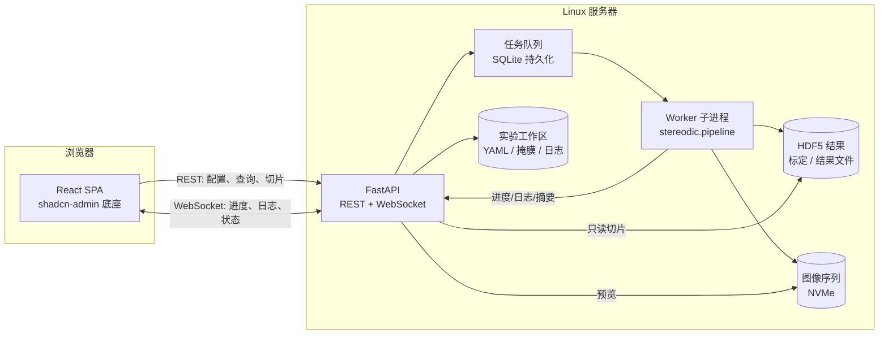
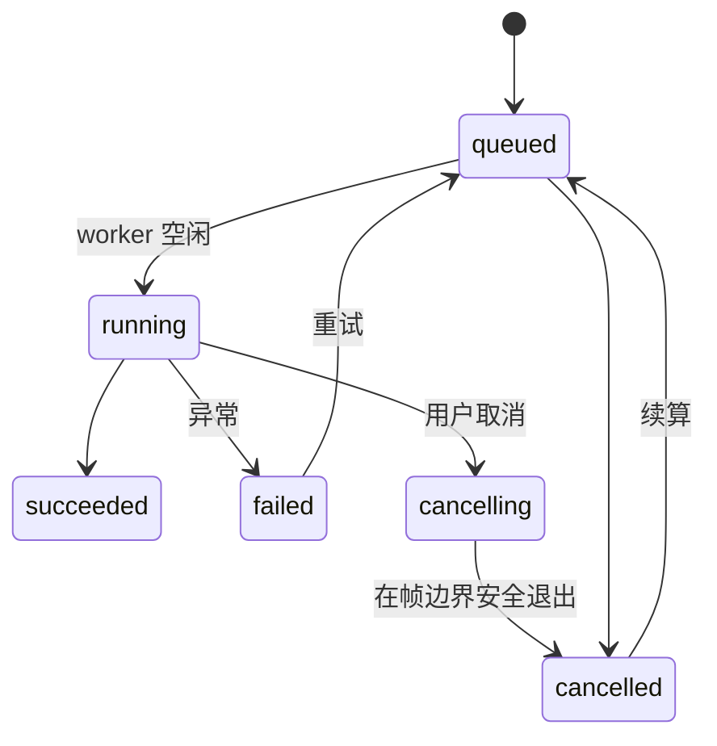

# StereoDIC Web UI 设计

> 文档版本：v0.1（设计稿，尚未实现）  
> 日期：2026-11-24  
> 关联文档：[StereoDIC_Technical_Design.md](StereoDIC_Technical_Design.md)、[振动实验台设定.md](振动实验台设定.md)  
> 定位：**数据处理 UI**。相机（暂定千眼狼 S1315，型号未最终确定）先把图像存在机身内存里，采集完成后再导出、拷到计算机上处理。UI 不控制相机，也不做实时采集。

## 目录

1. [目标与范围](#1-目标与范围)
2. [总体架构](#2-总体架构)
3. [技术选型](#3-技术选型)
4. [实验工作区与数据组织](#4-实验工作区与数据组织)
5. [任务执行模型](#5-任务执行模型)
6. [后端 API](#6-后端-api)
7. [页面设计](#7-页面设计)
8. [视觉与交互规范](#8-视觉与交互规范)
9. [`stereodic` 需要补的接口](#9-stereodic-需要补的接口)
10. [目录结构](#10-目录结构)
11. [里程碑](#11-里程碑)
12. [风险与待确认事项](#12-风险与待确认事项)

---

## 1. 目标与范围

### 1.1 目标

把现有命令行流程（`calibrate.py` → `run_dic.py --stage stereo|temporal|reconstruct|rbm` → `analyze.py` → `report_uncertainty.py`）整合进一个浏览器界面，做到：

1. **一站式**：从导入图像、检查数据、标定、画 ROI/掩膜，到看频率、振型和噪声底，都在一个界面里完成，不需要手改 YAML 或敲命令。
2. **可视化优先**：每一步都能直观看到中间结果。比如标定残差、POI 状态、三维形貌、逐帧有效点比例、全场频谱、振型动画。出了问题能马上定位到是哪一步。
3. **不简陋**：采用现代管理后台的设计体系，包括深浅色主题、命令面板、高密度数据布局和科学配色。
4. **不改算法**：UI 只调用 `stereodic` 的库函数。算法、配置模型和 HDF5 schema 都以现有代码为准；UI 需要的少量接口补在库里（§9），命令行脚本照常可用。

### 1.2 范围

| 包含 | 不包含 |
| --- | --- |
| 导入相机导出的图像序列（先支持 16 位 TIFF，厂商格式等拿到样例再加） | 相机控制：触发、帧率、曝光、下载机身内存 |
| T0 数据检查：灰度直方图、饱和、散斑尺寸、对焦、左右同步与丢帧 | 激振信号输出（声卡扫频/正弦），以后按需另做 |
| T1 标定、参考帧立体匹配、时序 DIC、重建、刚体补偿 | 多用户权限系统（第一版只考虑单人或小组共用一台服务器） |
| T2 噪声底、T4/T5 振动分析（谱、谐波、ODS、FDD、FRF、阻尼、MAC） | 移动端适配 |
| 不确定度传播与蒙特卡洛、结果导出与报告 | |
| 试验规划计算器（帧率/曝光/混叠/录制时长） | |

### 1.3 使用场景

```text
相机机身内存 ──厂商软件导出──▶ 采集电脑 ──拷贝/rsync──▶ Linux（A6000，本地 NVMe）
                                                         │
                                          stereodic-server（FastAPI + 任务队列）
                                                         │  HTTP / WebSocket
                                    浏览器（Mac 或实验室任意电脑，经 SSH 隧道访问）
```

数据和 GPU 都在 Linux 机器上，所以服务端也部署在 Linux 上，浏览器只负责显示。Mac 上开发时，用合成数据（§11 U0）在本机运行整套服务。

---

## 2. 总体架构



**设计要点：**

1. **API 进程不做重计算。** 帧预览、直方图、HDF5 切片读取这类轻量请求在 API 进程的线程池里完成。标定、立体匹配、时序 DIC 等长任务交给 worker 子进程。
2. **Worker 是独立子进程。** Numba/CUDA 的计算会长时间占用 GIL 和 GPU 上下文；放在子进程里，崩溃不会拖垮 API，也方便隔离 CUDA 上下文。
3. **一次只跑一个 GPU 任务。** 只有一块 A6000，重任务串行排队；轻任务（例如分析阶段）可以单独设并发数。
4. **HDF5 单写者。** 沿用现有约定：任务运行期间只有 worker 写结果文件。API 不打开正在写入的文件，运行中的进度和摘要由 worker 通过消息通道推送（§5.3）。
5. **前端是纯静态 SPA。** 构建产物由 FastAPI 一起托管，不需要额外的 Node 服务端。

---

## 3. 技术选型

### 3.1 前端底座：satnaing/shadcn-admin

调研结果（GitHub 星数取自 2026-11-24）：

| 候选 | ⭐ | 结论 |
| --- | ---: | --- |
| [satnaing/shadcn-admin](https://github.com/satnaing/shadcn-admin) | 17.0k | **选用**。Vite + React + TanStack Router/Query + zustand + shadcn/ui + Tailwind，MIT 许可；纯 SPA，自带深浅色主题、命令面板、侧边栏、数据表 |
| [Kiranism/next-shadcn-dashboard-starter](https://github.com/Kiranism/next-shadcn-dashboard-starter) | 7.3k | 基于 Next.js，要多一个 Node 服务端，不需要 |
| [ant-design-pro](https://github.com/ant-design/ant-design-pro) | 39.0k | 功能全，但风格偏传统企业后台，体量大 |
| [vue-pure-admin](https://github.com/pure-admin/vue-pure-admin) / [vue-vben-admin](https://github.com/vbenjs/vue-vben-admin) | 20.8k / 33.9k | Vue 方案的备选 |
| Streamlit / Gradio / NiceGUI / Reflex / Dash | 16–46k | 难以做出精致的重交互（画掩膜、三维动画、联动光标），不选 |

shadcn-admin 里的 Clerk 登录、示例页面（任务、用户、聊天）在初始化时删掉，只保留外壳：布局、侧边栏、主题、命令面板、表格、表单和通知组件。

### 3.2 前端依赖

| 用途 | 库 | 说明 |
| --- | --- | --- |
| 路由 / 服务端状态 / 本地状态 | TanStack Router、TanStack Query、zustand | 沿用底座 |
| 组件 | shadcn/ui（Radix）+ lucide 图标 + sonner 通知 | 沿用底座 |
| 表单 | react-hook-form + zod；配置表单由 JSON Schema 自动生成 | 配置项的唯一来源是后端 Pydantic 模型（§6.3） |
| 时间序列 / 频谱 | **uPlot**（10.7k ⭐） | Canvas 绘制，几十万点仍流畅；支持对数轴、缩放、多图光标同步 |
| 热力图 / 柱状图 / 矩阵 | **Apache ECharts**（67.8k ⭐） | 状态码时空图、逐视图 RMS、MAC 矩阵 |
| 三维形貌 / 振型动画 | **three.js + react-three-fiber + drei** | 网格按标量着色，ODS 动画在 GPU 里做顶点位移 |
| 图像查看与掩膜绘制 | **react-konva** | 缩放、平移、多边形/矩形/画笔，叠加 POI 和角点 |
| YAML 源码编辑 | CodeMirror 6 | 高级用户直接编辑 YAML |
| API 类型 | `@hey-api/openapi-ts`（计划） | 由 FastAPI 的 OpenAPI 自动生成 TS 客户端和类型；U0 先手写在 `webui/src/lib/api.ts` |
| `.npy` 解析 | 自写约 50 行的解析器 | 二进制数组传输（§6.2） |

现有的 Recharts 只保留给概览页的小图表；科学绘图统一用 uPlot 和 ECharts。

### 3.3 后端

| 用途 | 选择 |
| --- | --- |
| Web 框架 | FastAPI + uvicorn |
| 数据模型 | Pydantic v2（与 `stereodic.core.config` 共用） |
| 任务持久化 | SQLite（标准库 `sqlite3`，一张 jobs 表） |
| Worker | `multiprocessing`（spawn）子进程 + `Queue` 回传消息 |
| 图像编码 | OpenCV（PNG/WebP） |
| GPU 状态 | `nvidia-smi --query-gpu`（没有 GPU 时省略） |

后端依赖放进 `pyproject.toml` 的可选依赖组：`uv sync --extra web`。

---

## 4. 实验工作区与数据组织

### 4.1 为什么不直接编辑 `configs/experiments/`

仓库约定：**Linux 上只 `git pull`，不留未提交改动**；`configs/experiments/` 又是入库的。UI 运行在 Linux 上，如果直接改仓库里的 YAML，就会违反这条约定。所以 UI 管理的实验放在**数据目录下的工作区**，不进 git：

```text
<results_root>/experiments/<name>/
├── experiment.yaml        # 本实验配置（与命令行格式完全相同）
├── masks/
│   ├── poi_mask.png       # UI 绘制后栅格化
│   ├── poi_mask.json      # 多边形原始顶点，便于再次编辑
│   ├── rbm_mask.png
│   └── rbm_mask.json
├── calibration.h5         # + calibration.json / calibration.png
├── results.h5             # 结果文件（schema v1）
└── exports/               # 报告、CSV、NPZ 导出
```

- 任务数据库和日志放在 `<results_root>/.stereodic_server/`（`jobs.sqlite`、`logs/<job_id>.log`），因为任务不一定属于某个实验（例如测试任务）。
- `experiment.yaml` 里的 `calibration_file`、`output_file`、`poi_mask`、`rbm_mask` 用绝对路径指向工作区；`cameras.*.path` 指向 `data_root` 下的原始图像。
- **命令行完全兼容**：`uv run python scripts/run_dic.py --config <results_root>/experiments/<name>/experiment.yaml --stage temporal` 与在 UI 里点"运行"等价。
- UI 提供 **"导出 YAML"**（下载后可提交到仓库作为记录）和 **"从模板/已有实验新建"**。
- 同一套标定可以被多个实验共用：新建实验时可以选择"引用已有实验的标定"，`calibration_file` 指向那个实验的 `calibration.h5`。

### 4.2 阶段状态

每个实验在 UI 顶部显示一条流程状态条：

```text
导入 ─ 标定 ─ 参考帧/立体 ─ 时序 DIC ─ 重建 ─ 刚体补偿 ─ 分析 ─ 不确定度
 ✓      ✓        ✓           ● 62%      ○       ○        ○       ○
```

| 状态 | 判定 |
| --- | --- |
| 未运行 | 结果文件中没有该阶段 |
| 最新 ✓ | `progress/<stage>_done` 为真，且与当前配置算出的哈希一致 |
| 过期 ⚠ | 已完成，但当前配置的哈希变了，或上游阶段重算过 |
| 运行中 ● | 队列中有该实验该阶段的运行任务 |
| 中断 ◐ | 时序/重建阶段有部分 `dic_frames_done`，可以续算 |
| 失败 ✕ | 最近一次任务失败，可以查看日志 |

用户修改配置后，UI 立即显示哪些阶段会失效（例如改了 `dic.poi.step`，立体及其下游全部过期）。

> **注意**：`run_stereo` 会以 `overwrite=True` 重建整个结果文件，下游的时序、重建、分析结果都会被清空。UI 在重跑立体阶段前必须弹窗确认，说明会丢弃哪些结果。

---

## 5. 任务执行模型

### 5.1 任务类型

| 任务 | 调用 | 资源 | 可续算 |
| --- | --- | --- | --- |
| `calibrate` | `pipeline.run_calibration` | CPU | 否 |
| `stereo` | `pipeline.run_stereo` | CPU | 否 |
| `temporal` | `pipeline.run_temporal` | **GPU** / CPU | **是**（帧级） |
| `reconstruct` | `pipeline.run_reconstruct` | CPU | **是**（帧级） |
| `rbm` | `pipeline.run_rbm` | CPU | 否 |
| `analyze` | `pipeline.run_analyze`（§9 B2 新增） | CPU，内存大 | 否 |
| `uncertainty` | `pipeline.run_uncertainty`（§9 B3 新增） | CPU | 否 |
| `noise_floor` | `pipeline.run_noise_floor`（§9 B3 新增） | CPU | 否 |
| `pipeline` | 按顺序串联上述阶段，跳过已是最新的阶段 | — | 逐阶段 |

### 5.2 生命周期



- **取消是协作式的**：worker 在每帧或每个批次的边界检查取消标志，先 flush HDF5、写好 `dic_frames_done`，再抛出 `JobCancelled` 退出。这样取消后可以续算，文件也不会损坏。
- 只有协作取消超时（例如 60 s 没有响应）时才允许"强制终止"。UI 要提示：强制终止可能损坏正在写入的 HDF5 文件。
- 服务重启时，状态为 `running` 的任务标记为 `failed`（原因："服务重启"）；时序/重建阶段可以直接续算。

### 5.3 进度协议

`stereodic` 的各阶段函数新增一个可选参数 `progress: ProgressReporter | None`（§9 B1）。Worker 把每次回调转成消息，通过 `multiprocessing.Queue` 发给 API，API 再经 WebSocket 推送给浏览器：

```json
{"type": "progress", "job": "j_0042", "stage": "temporal", "done": 1830, "total": 5000,
 "rate": 41.2, "eta_s": 77, "message": "frame 1830"}
{"type": "summary", "job": "j_0042", "stage": "temporal", "frame": 1830,
 "valid_left": 0.987, "valid_right": 0.981, "znssd_median": 0.021}
{"type": "log", "job": "j_0042", "level": "INFO", "text": "..."}
{"type": "state", "job": "j_0042", "state": "succeeded"}
```

`summary` 消息让时序 DIC 运行时就能实时画出"逐帧有效点比例"曲线，而不需要 API 去读正在写入的 HDF5 文件。

---

## 6. 后端 API

所有路由在 `/api` 下。下文的 `{eid}` 是实验名，`{cam}` 取 `left` 或 `right`。

### 6.1 路由一览

**系统与文件**

| 方法 | 路径 | 说明 |
| --- | --- | --- |
| GET | `/system` | 可用后端（numpy/numba/cuda）、GPU 型号与显存、磁盘剩余、git commit |
| GET | `/fs?root=data&path=...` | 浏览 `data_root` 或 `results_root` 下的目录（**禁止访问根目录之外的路径**） |

**实验与配置**

| 方法 | 路径 | 说明 |
| --- | --- | --- |
| GET / POST | `/experiments` | 列出 / 新建（可选择模板或复制已有实验） |
| GET / PUT | `/experiments/{eid}/config` | 读写配置；支持 `?format=yaml` |
| POST | `/experiments/{eid}/config/validate` | Pydantic 校验，返回逐字段错误；同时返回修改后会失效的阶段 |
| GET | `/schema/experiment` | `ExperimentConfig` 的 JSON Schema，前端据此生成表单 |
| GET | `/experiments/{eid}/status` | 各阶段状态（§4.2） |

**图像与数据检查**

| 方法 | 路径 | 说明 |
| --- | --- | --- |
| POST | `/sequences/probe` | 输入目录和匹配模式，返回帧数、尺寸、dtype、有效位深估计、编号缺口、时间戳文件 |
| GET | `/experiments/{eid}/frames/{cam}/{i}.png` | 帧预览；参数 `lo`、`hi`（窗宽窗位）、`scale`、`roi`；服务端缩放并转 8 位 |
| GET | `/experiments/{eid}/frames/{cam}/{i}/stats` | 直方图、饱和比例、散斑尺寸估计、清晰度 |
| GET | `/experiments/{eid}/frames/{cam}/{i}/saturation.png` | 饱和区叠加图 |
| POST | `/experiments/{eid}/sync-check` | 左右时间戳配对、Δt 统计、丢帧（复用 `io/sync.py`） |
| GET | `/experiments/{eid}/sharpness?cam=left&stride=10` | 逐帧清晰度曲线，用于挑选运动模糊最小的参考帧 |

**掩膜**

| 方法 | 路径 | 说明 |
| --- | --- | --- |
| PUT | `/experiments/{eid}/masks/{kind}` | `kind` 取 `poi` 或 `rbm`；上传多边形 JSON，服务端栅格化成 PNG 并写回配置 |
| GET | `/experiments/{eid}/poi-preview` | 按当前子区、步长、ROI 和掩膜预览 POI 网格（只生成网格，不做匹配） |

**任务**

| 方法 | 路径 | 说明 |
| --- | --- | --- |
| POST | `/experiments/{eid}/jobs` | 提交任务：`{stage, params, force}` |
| GET | `/jobs`、`/jobs/{jid}` | 查询队列和任务详情 |
| POST | `/jobs/{jid}/cancel`、`/jobs/{jid}/retry` | 取消 / 重试或续算 |
| GET | `/jobs/{jid}/log?offset=` | 日志（增量读取） |
| WS | `/ws` | 推送进度、日志和状态（§5.3） |

**结果读取**（任务运行中对同一结果文件返回 `409`）

| 方法 | 路径 | 返回 |
| --- | --- | --- |
| GET | `/experiments/{eid}/calibration` | 标定报告 JSON：内参、畸变、基线、夹角、逐视图 RMS |
| GET | `/experiments/{eid}/calibration/views/{k}` | 某个视图的角点、重投影点和残差（需 §9 B5） |
| GET | `/experiments/{eid}/reference` | 参考帧 POI：二维坐标、三维点、法向、状态码、ZNSSD、重投影误差、三角网格 |
| GET | `/experiments/{eid}/dic/summary` | 逐帧有效比例、ZNSSD 中位数、状态码统计（需 §9 B7） |
| GET | `/experiments/{eid}/dic/status-map?t_bins=&n_bins=` | 帧 × 点的状态码降采样热力图 |
| GET | `/experiments/{eid}/field?kind=local\|raw\|rbm_local&t=` | 某一帧的全场位移 `(N,3)` |
| GET | `/experiments/{eid}/series?kind=...&points=...&max_samples=` | 选定点的时间序列 `(T,k,3)`；超过 `max_samples` 时按 min/max 降采样 |
| GET | `/experiments/{eid}/rbm` | `rbm_R`、`rbm_t` 时间序列 |
| GET | `/experiments/{eid}/vibration` | 峰值表、全场平均谱、阻尼 |
| GET | `/experiments/{eid}/vibration/harmonic/{key}` | 振幅、相位、残差、复数响应 `(N,3)` |
| GET | `/experiments/{eid}/vibration/fdd` | 奇异值谱、振型 |
| GET | `/experiments/{eid}/vibration/frf` | H1 与相干函数 |
| GET | `/experiments/{eid}/uncertainty/{key}` | 三维标准差、蒙特卡洛结果 |
| GET | `/experiments/{eid}/export?items=...&format=csv\|npz\|html` | 导出 |

### 6.2 数组传输格式

- 小对象（报告、峰值表、状态）用 JSON。
- **数组一律用 `.npy` 二进制**（`Content-Type: application/x-npy`）。它自带 dtype 和 shape，前端解析成 `Float32Array` 等类型数组，体积比 JSON 小 3–5 倍，解析也快一个数量级。
- 默认在服务端把 float64 转成 float32（显示精度足够）；导出接口保留 float64。
- 大数组不整块传输。全场数据按帧取 `(N,3)`；时间序列按点取，并限制最大点数；状态码时空图在服务端先降采样。
- 读取逐点时间序列时，把 h5py 的 chunk cache 设成 64 MB（`rdcc_nbytes`）。代码评审中实测：逐行读取从 46 ms 降到 1.1 ms。

### 6.3 配置表单

`ExperimentConfig.model_json_schema()` 直接给出完整的 JSON Schema，包括类型、取值范围、枚举和默认值。前端据此自动生成表单，再用一份前端 UI 提示表补充以下信息：

- 分组和顺序：相机、帧、ROI、DIC 参数、立体、时序、重建、标定；
- 中文标签、单位、说明（例如 `subset_size`：“子区边长 px，奇数”）；
- 高级项默认折叠（如 `solver.max_condition`、`seed_radius_px`）。

修改任意字段后，前端调用 `validate` 接口，在字段旁显示 Pydantic 返回的错误，并提示哪些阶段会失效。

---

## 7. 页面设计

### 7.1 外壳与导航

```text
┌──────────────┬──────────────────────────────────────────────────────────────┐
│ ◆ StereoDIC  │  实验: blade_T5_1000Hz ▾   [导入✓]-[标定✓]-[立体✓]-[时序●62%]… │
│              ├──────────────────────────────────────────────────────────────┤
│ 概览         │                                                              │
│ 任务队列  ③  │                                                              │
│ ──────────── │                         页面内容                              │
│ 实验         │                                                              │
│  · 配置      │                                                              │
│  · 数据导入  │                                                              │
│  · 标定      │                                                              │
│  · 参考帧    │                                                              │
│  · 时序 DIC  │                                                              │
│  · 重建      │                                                              │
│  · 振动分析  │                                                              │
│  · 质量      │                                                              │
│  · 报告      │                                                              │
│ ──────────── │                                                              │
│ 规划计算器   │                                                              │
│ 系统         │  ─────────────────────────────────────────────────────────── │
│ ◐ 主题       │  任务抽屉：temporal ▮▮▮▮▮▮▯▯▯ 62%  41 帧/s  ETA 1:17  [取消] │
└──────────────┴──────────────────────────────────────────────────────────────┘
```

- 顶栏：切换实验，显示流程状态条（§4.2），点击任一阶段跳转到对应页面。
- 底部任务抽屉：当前运行任务的进度条和日志尾部，可以展开或收起。
- 命令面板（⌘K）：搜索实验、跳转页面、执行"运行下一阶段"等操作。
- 侧边栏里各页面的顺序就是处理流程；当前阶段之后的页面在没有数据时显示引导，而不是空白。

### 7.2 概览

- 实验卡片：名称、描述、最近修改时间、流程进度、关键结果（例如主频、有效点比例）。
- 系统卡片：GPU 型号与显存占用、计算后端、数据盘剩余空间、当前 git commit。
- 最近任务列表。

### 7.3 实验配置

- 左侧：自动生成的分组表单（§6.3）；右侧：实时校验结果和"将失效的阶段"提示。
- 切换到"YAML"标签可以直接编辑源码，两种视图相互同步。
- 操作：保存、另存为新实验、导出 YAML、恢复默认值。

### 7.4 数据导入与检查（T0）

**导入向导：**

1. 在服务器文件浏览器中选择左、右相机目录（只能浏览 `data_root`），设置文件匹配模式；
2. 调用 `probe`，显示两路序列的帧数、分辨率、dtype、**有效位深**（例如"16 位容器，最大值 4095 → 12 位数据"）和编号缺口；
3. 指定时间戳文件（可选）、帧率、`sensor_origin`（相机录制窗口在全幅传感器上的位置）；
4. **触发对齐**：两台相机预触发长度可能不同，导出后同一时刻的帧号也可能不同。向导提供"左右帧偏移"设置，并用同步检查结果验证；
5. 写入配置。

**检查视图：**

```text
┌ 左相机 ─────────────────────┬ 右相机 ─────────────────────┐
│                              │                              │
│   图像（缩放/平移，联动）     │   图像                        │
│   [饱和区叠加] [直方图均衡]   │                              │
├──────────────────────────────┴──────────────────────────────┤
│ ◀ ▶  帧 1832 / 5000   ━━━━━━━━━━●━━━━━━━━━━━━  ▶ 播放 ×0.1  │
├──────────────┬──────────────┬──────────────┬────────────────┤
│ 灰度直方图    │ 饱和比例      │ 散斑尺寸      │ 左右同步 Δt     │
│ ▁▂▅█▇▃▁      │ 0.02 %  ✓    │ 3.8 px  ✓    │ max 0.4 µs ✓   │
└──────────────┴──────────────┴──────────────┴────────────────┘
```

- 左右图联动缩放和平移；可以逐帧、按帧号跳转或以低速播放。
- 指标卡片带判定，阈值取自设计文档：散斑 3–5 px、饱和比例、同步 Δt 上限。
- 逐帧清晰度曲线：帮助挑选参考帧（激振前的静止帧或运动模糊最小的帧）。

### 7.5 标定（T1）

```text
┌ 视图列表 ──────────┬ 视图 #07 ───────────────────────────────────────────┐
│ #  左角点 右角点 RMS│  左图（检出角点 ●、重投影点 +、残差箭头 ×100）        │
│ 01  54   54  0.04 ✓│                                                      │
│ 02  48   51  0.05 ✓│  右图                                                 │
│ 07  12    0   —  ✕ │                                                      │
│ …                  │                                                      │
├────────────────────┴──────────────────────────────────────────────────────┤
│ 结果  立体 RMS 0.035 px │ 基线 182.4 mm │ 夹角 29.6° │ fx 7512 / 7498 px  │
│ ┌ 逐视图 RMS（柱状，可点选剔除） ┐ ┌ 残差散点 ┐ ┌ 三维：相机与标定板位姿 ┐  │
└───────────────────────────────────────────────────────────────────────────┘
```

- 标定板参数表单（行列数、方格和码尺寸、字典），旁边实时渲染标定板示意图，方便核对。
- 先运行"仅检测"任务，列出每个视图左右检出的角点数；角点不足的视图自动标灰。
- 标定完成后显示：立体 RMS、基线、光轴夹角、内参及其标准差、逐视图 RMS 柱状图、残差散点、相机与标定板位姿的三维视图。
- 可以在柱状图上点选视图，手动剔除后重新标定（需要 §9 B5 的 `exclude_views` 字段）。
- 遵循设计文档 §3.5 的原则，在页面上明确提示：**重投影 RMS 只用于诊断，三维精度以 E2 位移台实验为准**；窄视场下内参逐项比较没有意义。

### 7.6 参考帧与立体匹配

1. **选择参考帧**：结合 §7.4 的清晰度曲线选帧。
2. **绘制区域**（左参考图上，使用 react-konva）：
   - ROI 矩形；
   - `poi_mask` 多边形（可做加减运算，例如扣掉反光区）；
   - `rbm_mask` 多边形：夹具上的静止参考散斑块，用另一种颜色显示。
3. **POI 预览**：调整子区大小和步长时，实时显示网格点数和子区示意框，并提示叶缘处会留下半个子区宽的空带。
4. **运行立体匹配**（如果会覆盖已有结果，先弹窗确认，见 §4.2）。
5. **结果**：
   - 左右图叠加 POI，按状态码或 ZNSSD 着色，鼠标悬停显示该点的 ID、坐标、ZNSSD 和重投影误差；
   - 状态码统计条（OK / OUT_OF_BOUNDS / LOW_TEXTURE …）；
   - **三维形貌**：三角网格按深度或重投影误差着色，可以显示法向和局部坐标系 (c, s, n)，用于检查 `recon.span_direction` 设置是否正确。

### 7.7 时序 DIC

- 参数区：计算后端（显示可用情况）、形函数阶数、帧范围和步长、帧批大小、跳变阈值。
- 运行中：
  - 进度、速率（帧/s）、ETA；
  - 实时曲线：逐帧左右有效点比例、ZNSSD 中位数（来自 `summary` 消息）；
  - 中断后显示"从第 1830 帧续算"。
- 完成后：
  - **状态码时空图**（ECharts 热力图，横轴帧、纵轴点，服务端降采样），失效集中在哪些帧、哪些区域一目了然；
  - 在左图上点选某个 POI，显示它的图像轨迹和 u/v 时间曲线。

### 7.8 重建与刚体补偿

- 一键依次运行 `reconstruct` 和 `rbm`；如果没有配置 `rbm_mask`，给出黄色警告（当前代码会退化为用全部有效点拟合刚体运动）。
- 刚体运动曲线：三个平移分量和三个旋转角随时间的变化。
- **全场位移浏览**：三维网格按所选分量（c / s / n 或模长）着色，配合时间轴拖动和播放；可以切换原始位移和补偿后位移。
- 点选任意 POI，显示三个分量的时间序列，原始与补偿后的曲线叠加对比（uPlot，多图光标同步）。

### 7.9 振动分析（T4 / T5）

```text
┌ 参数 ────────┬ 全场平均谱（对数）──────────────────────────────────────┐
│ 分量  [n ▾]  │      │╲    ▲ 1  ▲ 2                ▲ 3                  │
│ 刚体补偿 [✓] │      │ ╲__╱╲╱ ╲_______/╲___________╱╲________ 噪声底 ┄┄ │
│ 频率范围     │      └──────────────────────────────────────────────▶ Hz │
│ nperseg      ├ 峰值表 ────────────────────────────────────────────────┤
│ 峰数         │ #  频率 Hz   幅值 µm  SNR   阻尼比   [谐波拟合] [FDD]   │
│ 激振频率     │ 1  142.31    48.2     310   0.012    ▶                  │
│ 力信号文件   │ 2  611.80    7.5      95    —        ▶                  │
│ [运行分析]   │ 3  998.95    21.3     160   —        ▶                  │
├──────────────┴──────────────────────┬─────────────────────────────────┤
│ 振幅云图（三维网格）                  │ 相位云图（循环配色）              │
│ [▶ ODS 动画  放大 ×2000]             │                                  │
└─────────────────────────────────────┴─────────────────────────────────┘
```

- **宽带识频（T4）**：全场平均 Welch 谱（对数轴）、自动峰值表；可以叠加 E1 噪声谱作为参考线；已知干扰频率（50/100 Hz 及其倍频）用灰色竖线标出。
- **定频驻留（T5）**：
  - 输入激振频率（推荐）或点选峰值后，做谐波拟合；
  - 振幅云图和相位云图（相位用循环配色）；
  - **ODS 动画**：三维网格按 `Re(response · e^{iωt})` 做顶点位移，振幅可放大，带播放/暂停和速度控制。
- **混叠提示**：输入激振频率时，根据帧率实时计算它会混叠到哪个频率；如果混叠频率接近 0 或 fs/2，给出警告（对应设计文档 §11.3）。
- **FDD**：奇异值谱，以及点选频率处的模态振型。
- **FRF**：上传力信号文件，显示 H1 幅值、相位和相干函数。
- **MAC**：选择两次分析结果（或之后导入的 FEM 振型），显示 MAC 矩阵热力图。
- **显著性门限**：如果有噪声底结果，云图可以只显示振幅超过 kσ 的点（k 默认为 5），其余点显示为灰色。

### 7.10 质量与不确定度（T2）

- **噪声底（E1）**：选择一个"静态"实验（叶片静止时采集的数据），计算逐点、逐方向的噪声标准差，显示云图和噪声谱（用于检查照明频闪和环境振动）。这个结果可以被其他实验引用，作为显著性门限。
- **不确定度传播**：输入像素噪声 σ 和蒙特卡洛样本数，显示三维标准差云图，以及与设计文档 §3.4 几何估算的对比。
- **汇总卡片**：有效 POI 比例、缺测时间比例、状态码分布、同步 Δt。

### 7.11 报告与导出

- 一键生成 HTML 报告（可以用浏览器打印成 PDF），内容包括：实验信息与 git commit、数据检查、标定结果、质量指标、频率表、振型截图、噪声底；
- 数据导出：频率表 CSV；选定点的时间序列 CSV；全场振幅/相位 NPZ；三维形貌 PLY。

### 7.12 规划计算器

纯前端计算，不依赖任何实验数据：

| 输入 | 输出 |
| --- | --- |
| 帧率、分辨率、机身内存或最大帧数 | 可录制时长、频率分辨率 Δf = 1/T |
| 目标频率 f、帧率 fs | 是否满足 fs ≥ 2.5f；混叠后的频率；是否接近 0 或 fs/2 |
| 振幅 A、物方比例 s、允许模糊 δ | 曝光时间上限 t_exp ≲ δs / (2πfA) |
| 夹角 α、像素噪声 σp、帧数 N | 单帧面内/离面噪声、谐波拟合后的噪声底 |

公式与设计文档 §3.2、§3.4、§11.3 和《振动实验台设定》§5 保持一致。S1315 的具体参数确认后，可以作为预设填入。

### 7.13 任务队列与系统

- 任务表：状态、实验、阶段、提交时间、耗时、进度；支持取消、重试、查看日志。
- 系统页：`scripts/check_env.py` 的输出、`local.yaml` 中的根目录、各计算后端是否可用、GPU 状态。

---

## 8. 视觉与交互规范

| 项目 | 约定 |
| --- | --- |
| 主题 | 默认深色（看图像和云图更舒服），可切换浅色；跟随 shadcn 的主题变量 |
| 字体 | 界面用 Inter + Noto Sans SC；数值、帧号、坐标用 JetBrains Mono，等宽且使用 tabular-nums |
| 密度 | 偏紧凑；参数面板宽约 280 px，主视图尽量大 |
| 标量配色 | 幅值类用 viridis；带符号位移用发散色图（RdBu）并以 0 为中心对称；相位用循环色图（twilight） |
| 状态码配色 | 全局统一：OK 绿，OUT_OF_BOUNDS 灰，LOW_TEXTURE 棕，ILL_CONDITIONED 紫，NOT_CONVERGED 橙，HIGH_RESIDUAL 红，GEOMETRY_INCONSISTENT 品红，TEMPORAL_JUMP 黄，MASKED 深灰 |
| 单位 | 长度显示 µm 或 mm（可切换），频率 Hz，相位 °（存储仍用 rad） |
| 判定 | 指标卡片使用 ✓ / ⚠ / ✕ 三档，阈值在悬停提示中写明来源 |
| 空状态 | 每个页面在没有数据时显示"下一步该做什么"和跳转按钮 |
| 危险操作 | 覆盖结果、强制终止都要二次确认，并说明后果 |
| 快捷键 | ⌘K 命令面板；←/→ 逐帧；空格播放/暂停 |

---

## 9. `stereodic` 需要补的接口

以下改动都在库里完成，命令行脚本同步改为调用这些函数。UI 开发依赖这些改动，所以在对应里程碑之前完成。

| 编号 | 内容 | 现状 | 所需改动 |
| --- | --- | --- | --- |
| **B1** | 进度与取消 | `pipeline.run_*` 只写日志 | 新增 `ProgressReporter` 协议（`update(done, total, msg)`、`summary(dict)`、`check_cancel()`），各阶段加可选参数 `progress=None`；时序和重建在帧边界、标定在视图边界、立体匹配在传播批次边界回调 |
| **B2** | 分析阶段入库 | 峰值、谐波、FDD、FRF、阻尼逻辑写在 `scripts/analyze.py` 的 `main()` 里 | 抽成 `pipeline.run_analyze(cfg, AnalyzeOptions)`，`AnalyzeOptions` 用 Pydantic 定义，脚本只解析参数 |
| **B3** | 不确定度与噪声底入库 | `report_uncertainty.py` 的逻辑在脚本里；`quality/noise_floor.py` 没有接入任何阶段 | 新增 `run_uncertainty`、`run_noise_floor`，结果写入 `quality/noise_floor` 和 `uncertainty/` |
| **B4** | 阶段哈希与状态 | 哈希计算分散在各个 `run_*` 函数里 | 抽出 `stage_hash(cfg, stage)` 和 `stage_status(cfg) -> dict`，UI 和 pipeline 共用 |
| **B5** | 标定明细 | 只保存汇总报告；逐视图角点、位姿、剔除情况都没有保存 | 把检测结果（角点 ID、坐标）、每个视图的位姿和残差写进 `calibration.h5`；新增配置 `calibration.exclude_views`；检测和标定拆成两步，以便先检测、再标定 |
| **B6** | 序列探测与图像质量 | 只有 `TiffSequence`；设计文档中的 `quality/image.py` 尚未实现 | `probe_sequence()`（帧数、尺寸、dtype、有效位深、编号缺口）；`quality/image.py`（直方图、饱和比例、散斑尺寸自相关估计、清晰度） |
| **B7** | 时序摘要 | 没有逐帧汇总 | 时序阶段写入 `quality/frame_summary`（逐帧左右有效比例、ZNSSD 中位数），同时通过 `progress.summary()` 推送 |
| **B8** | 读取器注册 | `open_sequence` 写死为 TIFF 目录 | 改成按格式注册的读取器；千眼狼的厂商格式拿到样例文件后再接入 |
| **B9** | 帧偏移 | 配置里没有左右帧偏移 | 视触发方式而定：在 `CameraSource` 中加 `frame_offset`，或者在导入时统一裁齐 |

> 代码评审中发现的分析层问题（谐波拟合用 Welch 峰频带来的振幅偏差、µs 级时间戳被 FFT 路径拒绝、半功率阻尼在默认 `nperseg` 下偏大等）会直接影响 UI 显示的结果，应在 U5 振动分析页面上线前修复。

---

## 10. 目录结构

```text
HS-3D-DIC/
├── stereodic/                 # 算法库（不变，仅按 §9 补接口）
├── stereodic_server/          # 新增：Web 后端（Python）
│   ├── __main__.py            # `uv run python -m stereodic_server --port 8000`
│   ├── app.py                 # FastAPI 应用、静态文件托管
│   ├── settings.py            # 监听地址、根目录、并发数
│   ├── workspace.py           # 实验工作区（§4）
│   ├── jobs/                  # 队列、SQLite、worker、进度协议
│   ├── routes/                # system, fs, experiments, frames, masks, jobs, results, export
│   ├── services/              # 帧预览、栅格化、降采样、报告生成
│   └── npy.py                 # .npy 响应
├── webui/                     # 新增：前端（基于 shadcn-admin）
│   ├── src/
│   │   ├── routes/            # TanStack Router 文件路由，对应 §7 各页面
│   │   ├── features/          # 各页面业务组件
│   │   ├── components/viz/    # ImageViewer(Konva)、Mesh3D(R3F)、SeriesPlot(uPlot)、Heatmap(ECharts)、colormaps
│   │   ├── api/               # 由 OpenAPI 生成的客户端 + npy 解析 + WebSocket
│   │   └── stores/            # zustand：当前实验、任务、显示设置
│   └── package.json
├── scripts/
│   └── make_demo_dataset.py   # 新增：用 synth 生成一套带标定图的 S6 演示数据
└── tests/server/              # 新增：API 测试（httpx + 小型合成数据）
```

**开发与部署：**

```bash
# Mac 开发：后端 + 前端热更新（Vite 把 /api 代理到 8000 端口）
uv sync --extra web
uv run python -m stereodic_server --reload
cd webui && pnpm install && pnpm dev

# Linux 部署：构建前端后由 FastAPI 托管，只监听本机
git pull && uv sync --extra cuda --extra web
cd webui && pnpm install && pnpm build && cd ..
uv run python -m stereodic_server --host 127.0.0.1 --port 8000

# 在 Mac 上通过 SSH 隧道访问
ssh -N -L 8000:127.0.0.1:8000 <linux-host>
# 浏览器打开 http://localhost:8000
```

- `webui/dist/` 和 `node_modules/` 加入 `.gitignore`；Linux 上需要安装 Node 和 pnpm 来构建前端。
- 默认只监听 `127.0.0.1`，通过 SSH 隧道访问，因此第一版不需要登录系统。如果以后要在实验室局域网内直接访问，再加访问令牌。

---

## 11. 里程碑

| 里程碑 | 内容 | 依赖的 §9 项 | 出口 |
| --- | --- | --- | --- |
| **U0 骨架** | 裁剪 shadcn-admin；FastAPI 骨架；系统页、文件浏览、实验增删改；由 Schema 生成配置表单；任务队列 + WebSocket（先用一个模拟任务）；`make_demo_dataset.py` | B1、B4 | 在 Mac 上新建演示实验、编辑配置，模拟任务的进度能实时显示 |
| **U1 导入与检查** ✅ | 导入向导、左右联动帧查看器、直方图/饱和/散斑/清晰度、同步检查、规划计算器 | B6、B8、B9 | 演示数据通过（真实导出数据待相机到位后验证） |
| **U2 标定** | 检测 → 视图列表 → 标定 → 结果（RMS、残差、三维位姿）→ 剔除视图重标 | B5 | 合成 ChArUco 数据的标定结果与命令行一致 |
| **U3 参考帧与立体** | 掩膜绘制、POI 预览、立体任务、POI 叠加、三维形貌 | — | 演示数据的形貌误差与 B04 量级一致 |
| **U4 时序、重建、补偿** | 运行/续算/取消、实时摘要、状态码时空图、位移场浏览、点时间序列 | B7 | 中途取消后可以续算，结果与不中断时一致 |
| **U5 分析与质量** | 谱与峰值、谐波拟合、ODS 动画、FDD、FRF、MAC、噪声底、不确定度、报告导出 | B2、B3 + 分析层修复 | 演示数据（S6）的频率、振幅、相位与真值吻合；报告可以打印 |
| **U6 Linux 部署** | 在 A6000 上部署，用 CUDA 后端跑完整数据集 | — | 2 万 POI × 数千帧的实验能完整跑通，浏览器端交互流畅 |

**演示数据**：`scripts/make_demo_dataset.py` 调用现有的 `synth/`（ChArUco 标定图 + S6 曲面简谐振动），生成一套与真实目录结构相同的数据，包括 TIFF 序列、时间戳、标定图像和真值文件。在 Mac 上开发 UI 时不依赖相机和 GPU，同时也作为端到端回归测试数据。

---

### 11.1 U0 完成情况（2026-11-24）

- `stereodic`：`core/progress.py`（进度、阶段、摘要、协作取消），`calibrate`、`stereo`、`temporal`、`reconstruct`、`rbm` 均接入；`pipeline.stage_status(cfg)` 返回各阶段 missing / done / stale / partial / unknown，并沿依赖传播过期（B1、B4）。
- `stereodic/synth/demo.py` + `scripts/make_demo_dataset.py`：12 个 ChArUco 视图 + 160 帧曲面扭转 137 Hz / 平动 412 Hz，目录结构与真实导出一致。
- `stereodic_server`：实验工作区、配置校验与失效预览、沙箱文件浏览、SQLite 任务队列、spawn 子进程 worker、WebSocket 推送、静态托管 `webui/dist`。
- `webui`：概览、实验列表/新建/复制/删除、Schema 表单 + YAML 编辑器、运行菜单、底部任务栏、任务队列与日志、系统页；U1–U5 页面先显示计划内容。
- 测试：`tests/server/test_api.py`（含在演示数据上真实运行 stereo → temporal → reconstruct）、`tests/integration/test_progress_status.py`（取消后续算、阶段状态）。
- 在 Mac（Numba）上用演示数据从 UI 提交：标定约 1 s（立体 RMS 0.036 px、夹角 20.01°）；流水线 stereo → rbm 约 20 s（945 个 POI × 160 帧）。

### 11.2 U1 完成情况（2026-11-24）

- `stereodic`：
  - 读取器注册（`io/readers`）：TIFF 目录、PNG/BMP 目录（OpenCV，保留原始位深；JPEG 等有损格式拒绝）；相机厂商格式以后注册一个 `Reader` 即可（B8）。
  - 帧偏移（B9）：`cameras.*.frame_offset` 跳过该相机导出的开头若干帧；时间戳文件同步平移；`time/frame_ids` 记录原始导出序号。左右帧数不同时，必须把 `frames.stop` 限制在共同长度内，否则报错并提示。新字段取默认值时不进入阶段哈希，已有结果不会因升级而过期。
  - `io/probe.py`：帧数、尺寸、存储位深与有效位深（识别“12 位数据左对齐存 16 位”）、文件名编号缺口、时间戳候选文件（B6）。
  - `quality/image.py`：直方图、饱和比例、量程利用、对比度、平均梯度 MIG、散斑尺寸（自相关半高宽，按合成散斑标定，±20%）、归一化梯度能量（清晰度）。
  - `io/sync.py`：`sync_summary` / `timing_summary`，配对、同步偏差、未配对帧、帧间隔间隙。
- `stereodic_server`：`POST /sequences/probe`、`GET /experiments/{eid}/sequences`、`/frames/{cam}/{k}.png`（自动/全量程窗口、饱和标红、缩放）、`/frames/{cam}/{k}/report`、`/sync`、`/sharpness`。只读原始图像，任务运行中也可用。
- `webui`：数据导入页（左右序列编辑与探测、写入配置、帧偏移、联动缩放平移的双图查看器与播放、逐帧检查卡片、清晰度曲线与参考帧设置、同步卡片）；规划计算器（录制时长与 Δf、混叠判定、曝光上限、噪声底与可测最小振幅）。
- 测试：`tests/unit/test_import_checks.py`、`tests/integration/test_frame_offset.py`（偏移导出与对齐导出结果一致）、`tests/server/test_api.py::test_import_endpoints`。

### 11.3 U2 完成情况（2026-11-24）

- `stereodic`：角点检测与标定拆分（B5）。`run_calibration_detect` 把每个视图左右的角点存到 `<calibration>_detections.h5`，按标定板参数和图像文件指纹缓存；`run_calibration` 复用缓存，按 `calibration.exclude_views` 剔除视图；标定文件新增 `details/`（每对视图的角点 ID、检测点、残差、标定板位姿、单目使用标记）。
- `stereodic_server`：`/experiments/{eid}/calibration`（状态、检测、报告、逐视图 RMS、全部残差）、`/views/{i}`、`/views/{i}/{cam}.png`、`/board.png`、`/poses`；任务新增 `calibrate_detect`。
- `webui`：标定页（状态与操作、结果与内参、视图表勾选剔除并重新标定、逐视图角点与放大残差叠加、逐视图 RMS 柱状图、残差散点、相机与标定板三维位姿、标定板参数与实时渲染预览）。
- 测试：`tests/integration/test_calibration_stage.py`、`tests/server/test_api.py::test_calibration_endpoints`。

### 11.4 U3 完成情况（2026-11-25）

- `stereodic/dic/masks.py`：多边形掩膜（加入 / 扣除，按顺序叠加；首个为扣除时从整幅图开始），栅格化为 8 位 PNG（`poi_mask` / `rbm_mask` 的格式），形状存在同名 JSON 中以便再次编辑；拒绝面积 < 1 px² 的退化多边形。
- `stereodic_server`：`GET/PUT /experiments/{eid}/masks`（ROI、测量区域、刚体参考区、子区与步长一并保存，先校验后写文件）、`POST /poi-preview`（按未保存的形状实时生成测点网格）、`GET /reference`（参考帧测点、状态码、ZNSSD、重投影误差、三维点与三角网格、局部坐标系平均方向）；启用 gzip。
- `webui`：参考帧页（Konva 绘制 ROI / 加入 / 扣除 / 刚体参考区，滚轮缩放与平移，子区与步长修改时测点网格实时更新，光标处显示子区范围；立体匹配结果按状态码 / ZNSSD / 重投影误差 / 深度着色的左右叠加图，悬停显示单点信息；三维形貌网格与 c、s、n 轴）。
- 测试：`tests/unit/test_masks.py`、`tests/server/test_api.py::test_reference_endpoints`（保存的掩膜确实被立体匹配使用）。

## 12. 风险与待确认事项

| 事项 | 影响 | 对策 / 需要确认 |
| --- | --- | --- |
| 千眼狼 S1315 尚未最终确定，导出格式、位深、时间戳不明 | 导入模块（B8、B9） | 先支持 16 位 TIFF；确认相机能否无损导出原始位深（**不能用 8 位或 AVI**）、能否导出逐帧时间戳和帧号、双相机如何共用触发并标出触发帧 |
| 机身内存限制录制时长 | 频率分辨率、谐波拟合的噪声 | 规划计算器提前估算 |
| 大数据量下的内存（FDD 约需 9 GB） | 分析任务可能内存不足 | 分析阶段放进 worker 子进程，并在提交前估算内存；按需改成分块计算 |
| HDF5 读写并发 | 运行中读取同一文件可能出错 | 单写者 + 运行中返回 409 + 进度走消息通道（§2、§5.3）；以后有需要再评估 SWMR 模式 |
| 强制终止任务可能损坏 HDF5 | 结果文件失效 | 默认协作取消；强制终止前二次确认 |
| 浏览器端三维渲染压力（2 万点网格动画） | 交互卡顿 | 顶点位移放在 shader 中计算；必要时对显示网格降采样 |
| Linux 上需要 Node 环境 | 部署多一步 | 或者在 Mac 上构建后 rsync `webui/dist` 到 Linux |
