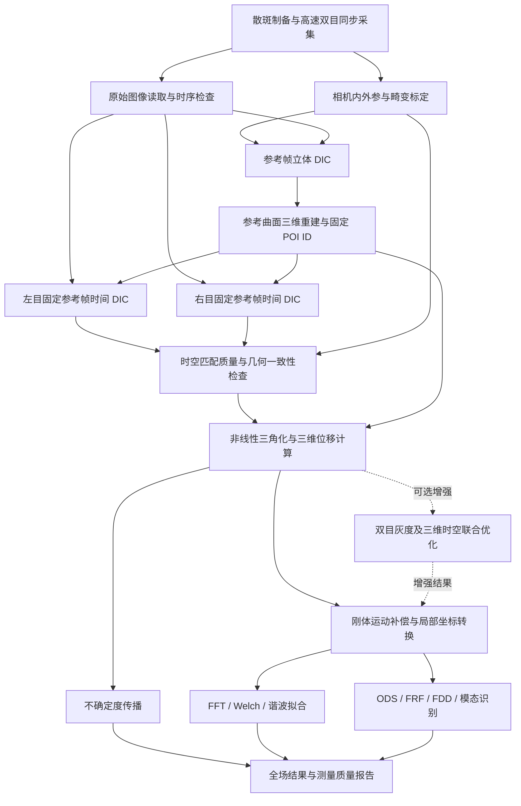
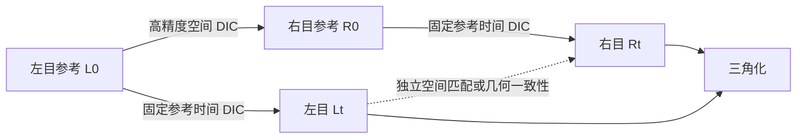

# StereoDIC：高精度双目 DIC 叶片振动测量技术设计

> 文档版本：v0.1（设计草案）  
> 项目名称：StereoDIC  
> 英文定位：Training-free, high-precision, full-field 3D optical vibration measurement framework  
> 适用对象：具有随机散斑的复杂曲面薄壁叶片；第一阶段以固定夹持的非旋转叶片为对象。

## 目录

1. [项目目标与设计原则](#1-项目目标与设计原则)
2. [总体技术路线](#2-总体技术路线)
3. [实验系统与标定](#3-实验系统与标定)
4. [代码目录架构](#4-代码目录架构)
5. [基础数据结构与计算约定](#5-基础数据结构与计算约定)
6. [核心 DIC 算法](#6-核心-dic-算法)
7. [双目三维重建与位移计算](#7-双目三维重建与位移计算)
8. [匹配质量与不确定度](#8-匹配质量与不确定度)
9. [振动分析与模态识别](#9-振动分析与模态识别)
10. [高精度联合优化拓展](#10-高精度联合优化拓展)
11. [数据存储与流水线](#11-数据存储与流水线)
12. [软件技术栈](#12-软件技术栈)
13. [合成数据与精度验证](#13-合成数据与精度验证)
14. [开发阶段与验收标准](#14-开发阶段与验收标准)
15. [风险、边界与待确认参数](#15-风险边界与待确认参数)
16. [参考资源](#16-参考资源)

## 1. 项目目标与设计原则

### 1.1 研究目标

采用两台硬件同步触发的高速相机，对具有随机散斑的叶片表面进行数字图像相关（Digital Image Correlation, DIC）分析，建立同一物质点在左右相机和不同时刻之间的对应关系，实现高精度三维全场振动测量。

主要输出：

- 叶片共同可见区域的初始三维曲面及物质点坐标；
- 逐时刻三维位移场及叶片局部弦向、叶展方向、法向位移；
- 振动频率、幅值、相位及工作变形振型（ODS）；
- 在满足激励和辨识条件时，计算固有频率、模态振型及阻尼比；
- 匹配质量、有效测量区域、误差分布和测量不确定度；
- 后续拓展至动态应变、双目灰度联合优化和时空联合微振动反演。

双目系统只能直接测量两台相机共同可见的叶片表面。若要同时观测正反两面或存在遮挡的区域，需要额外相机或在可重复、相位同步的周期实验中采用多视角测量。

### 1.2 不可妥协的技术原则

1. **精度优先于计算速度。** 第一阶段以离线处理为主，不设置实时性硬指标。
2. **完全无深度学习依赖。** 不使用 FoundationStereo、RAFT、RoMa 或其他学习式立体匹配、光流、特征匹配和深度估计模型。允许 SIFT、ZNCC、FFT-CC 等传统方法提供初值。
3. **物质点追踪优先于逐帧点云重建。** 所有时间帧共享稳定的 POI ID，避免逐帧重建后通过最近邻或 ICP 推断位移。
4. **原始灰度优先。** 最终 DIC 优化在原始畸变图像上进行，尽量避免整幅图像的重复几何重采样。
5. **高精度数值计算。** 几何和 DIC 优化使用 Float64；不得以降低精度换取不必要的速度提升。
6. **固定参考帧。** 小幅周期振动以固定参考帧为基准，前一帧仅作为初值，避免累积漂移。
7. **验证先于优化。** 所有高阶插值、形函数、联合优化及加速版本均需要独立基准测试和真实实验验证。
8. **可追溯性。** 原始数据、标定、配置、算法版本、测量质量及失败状态必须可追溯；原始测量与插补、滤波、拟合结果应分开保存。

初步目标是微米级三维动态位移测量和更高灵敏度的周期振幅估计。该目标不是已验证性能，必须结合硬件和实际实验确定。

## 2. 总体技术路线



基础版本采用经典局部 Stereo-DIC：参考帧空间匹配只执行一次，随后左右目分别在时间序列中追踪，再进行几何重建。高级版本在这一基线基础上逐步增加三维灰度联合优化与多帧约束。

## 3. 实验系统与标定

### 3.1 硬件及成像设计

| 项目 | 初始建议 |
| --- | --- |
| 相机 | 两台同型号黑白高速相机，全局快门，原始位深采集 |
| 镜头 | 低畸变定焦镜头，焦距与工作距离由视场和精度要求决定 |
| 双目布置 | 初步试验会聚夹角 20°–35°，通过深度灵敏度、遮挡和散斑透视变化联合优化 |
| 同步 | 公共时钟或硬件 TTL 触发；验证实际曝光中心时刻偏差 |
| 支架 | 刚性相机支架，与激振平台隔离 |
| 照明 | 高亮无频闪连续光源，必要时漫射或交叉偏振，避免饱和 |
| 散斑 | 哑光薄底漆、随机黑色散斑；典型成像直径 3–5 px，覆盖率约 40%–60% |
| 激振 | 电磁激振器、模态力锤或压电激振，根据目标频率选择 |
| 参考仪器 | 精密位移台、激光多普勒测振仪（LDV）；必要时同步采集力信号 |

散斑涂层质量可能影响薄壁叶片的固有频率和阻尼，应尽量轻薄，并视情况比较喷涂前后的响应。相机采集应保留原始 TIF/CINE/MRAW 等数据和有效位深，不进行有损压缩、自动增益变化或非必要降噪。

### 3.2 帧率、曝光和同步

设最高目标频率为 $f_{max}$，理论采样下限为 $f_s>2f_{max}$；初步工程设计建议 $f_s=(5\sim20)f_{max}$，具体取值依据混叠风险、频谱范围、相位精度与高速相机 ROI 决定。

对于简谐运动，设投影方向物方振幅为 $A$、局部比例为 $s$（mm/px）、允许运动模糊为 $\delta$（px），则

$$
 v_{max}=2\pi f A,\qquad t_{exp}\lesssim\frac{\delta s}{2\pi f A}.
$$

初期可采用 $\delta=0.1$ px 评估曝光上限，但最终需以各相机实际投影像素速度、光照及误差预算验证。两相机曝光时间差 $\Delta t$ 会造成约 $v\Delta t$ 的运动错配，且相位偏差约为 $2\pi f\Delta t$。须实测同步误差，而不是只检查帧率一致性。

频率分辨率 $\Delta f=1/T_{acq}$，因此帧率与采集总时长须分别设计。应保存实际时间戳和丢帧信息，避免默认为严格等间隔采样。

### 3.3 标定策略

相机参数定义为

$$
 \theta=\{K_L,D_L,K_R,D_R,R_{RL},t_{RL}\},\qquad X_R=R_{RL}X_L+t_{RL}.
$$

- 使用高精度棋盘格或圆点标定板，初期采集 20–40 组不同深度和姿态的图像，覆盖实际测量体积。
- 标定应与高速采集保持相同分辨率、ROI、镜头焦距、光圈与安装状态；ROI 裁剪必须正确转换坐标和主点。
- 优先实现针孔相机 + Brown–Conrady 畸变模型，是否使用更复杂模型由独立验证数据决定。
- 先使用 OpenCV 初始化，再对内参、畸变、双目外参和各标定板位姿执行联合非线性优化（参考坐标固定，保证尺度与规范自由度约束）。
- 保存每帧、每点重投影误差、参数相关性、独立验证误差及标定数据来源；0.1–0.2 px RMS 可作为初步诊断指标，而不是三维位移准确度证明。
- 建议使用已知三维位移和不同空间位置的标定物检验尺度误差、深度偏差和空间非均匀性。

最终亚像素 DIC 在原始畸变图像中完成；只对匹配后的亚像素坐标进行去畸变，或直接使用含畸变的投影模型优化。极线粗搜索可在校正域完成，但精细匹配回到原始坐标域。畸变图像中的对应轨迹通常是曲线，不应直接套用直线极线公式。

## 4. 代码目录架构

```text
StereoDIC/
├── pyproject.toml
├── README.md
├── configs/
│   ├── camera.yaml
│   ├── calibration.yaml
│   ├── dic.yaml
│   ├── vibration.yaml
│   └── experiment.yaml
├── stereodic/
│   ├── __init__.py
│   ├── core/
│   │   ├── types.py                  # 相机、POI、匹配/重建结果与状态码
│   │   ├── config.py                 # YAML 配置与校验
│   │   └── constants.py              # 单位、约定及公共常量
│   ├── io/
│   │   ├── readers/                  # TIF/CINE/MRAW 等读取适配器
│   │   ├── sequence.py               # 懒加载、帧索引、ROI、原始位深
│   │   ├── synchronization.py        # 时间戳配对、丢帧与同步检查
│   │   ├── storage.py                # HDF5 分块读写、缓存及续算
│   │   └── metadata.py               # 实验及相机元数据
│   ├── calibration/
│   │   ├── detection.py              # 标定点检测与亚像素定位
│   │   ├── intrinsic.py              # 单目内参
│   │   ├── stereo.py                 # 双目外参
│   │   ├── camera_model.py           # 投影、去畸变、反投影、雅可比
│   │   ├── bundle_adjustment.py      # 联合非线性标定
│   │   └── evaluation.py             # 标定与空间误差报告
│   ├── dic/
│   │   ├── mesh.py                   # ROI 掩膜、POI 网格及邻接关系
│   │   ├── subset.py                 # 子区提取、掩膜、有效像素
│   │   ├── interp.py                 # B 样条预滤波、连续灰度插值
│   │   ├── gradient.py               # 插值一致的灰度梯度
│   │   ├── criteria.py               # ZNSSD / ZNCC
│   │   ├── shape_functions.py        # 零阶、一阶、二阶形函数
│   │   ├── icgn.py                   # IC-GN 求解器
│   │   ├── iclm.py                   # IC-LM 阻尼求解器（扩展）
│   │   ├── init_guess.py             # FFT-CC、极线搜索、SIFT、仿射初值
│   │   ├── rgdic.py                  # 可靠性引导传播
│   │   ├── stereo_match.py           # L0 ↔ R0 初始空间对应
│   │   ├── temporal.py               # L0 → Lt、R0 → Rt 批量时间追踪
│   │   └── joint/
│   │       ├── geometric.py          # 双目几何一致性与加权重建入口
│   │       ├── photometric.py        # 三维参数化、原始双目灰度优化
│   │       └── spatiotemporal.py     # 多帧联合/谐波约束反演
│   ├── recon/
│   │   ├── triangulate.py            # 线性初始化、非线性三角化
│   │   ├── displacement.py           # 三维物质点位移
│   │   ├── surface.py                # 参考曲面、法向及曲面拓扑
│   │   ├── frames.py                 # 叶片局部坐标系
│   │   └── rbm.py                    # 刚体运动估计与可选补偿
│   ├── quality/
│   │   ├── speckle.py                # 散斑尺寸、对比度、SSSIG 等
│   │   ├── image.py                  # 噪声、饱和、模糊检查
│   │   ├── correlation.py            # 残差、收敛性、可观测性评价
│   │   ├── consistency.py            # 前后向、极线、时空闭环检查
│   │   └── validity.py               # 有效掩膜与失败状态管理
│   ├── uncertainty/
│   │   ├── dic_noise.py              # DIC 随机噪声与偏差建模
│   │   ├── calibration.py           # 标定不确定度
│   │   ├── propagation.py            # 雅可比与协方差传播
│   │   └── monte_carlo.py            # 联合蒙特卡洛验证
│   ├── vibration/
│   │   ├── preprocessing.py          # 去趋势、缺测、窗函数
│   │   ├── spectrum.py               # FFT、Welch、峰值插值
│   │   ├── harmonic.py               # 多帧幅值与相位拟合
│   │   ├── ods.py                    # 工作变形振型
│   │   ├── fdd.py                    # 频域分解模态识别
│   │   ├── frf.py                    # 有力信号时的频响函数
│   │   ├── damping.py                # 阻尼识别
│   │   └── mac.py                    # 模态振型一致性
│   ├── synth/
│   │   ├── speckle.py                # 连续、高分辨率散斑模型
│   │   ├── deformation.py            # 平移、仿射及三维变形真值
│   │   ├── rendering.py              # 独立投影、渲染与像素积分
│   │   ├── sensor.py                 # 光学模糊、噪声及量化
│   │   └── stereo.py                 # 同步双目序列与真值
│   ├── validation/
│   │   ├── noise_floor.py            # 静态噪声底
│   │   ├── translation.py            # 标准位移验证
│   │   ├── dynamic.py                # 动态幅频相验证
│   │   └── reference.py              # LDV / FEM 对比与统计
│   ├── viz/                          # 云图、频谱、振型动画
│   └── pipeline.py                   # 分阶段编排、缓存、断点续算
├── scripts/
│   ├── calibrate.py
│   ├── run_dic.py
│   ├── analyze.py
│   └── validate.py
├── tests/
│   ├── unit/
│   ├── integration/
│   └── regression/
├── benchmarks/
│   ├── interpolation/
│   ├── shape_function/
│   ├── subpixel_bias/
│   ├── triangulation/
│   └── vibration/
├── notebooks/
├── docs/
│   ├── conventions.md
│   ├── technical_design.md
│   └── data_schema.md
└── results/                          # 运行产物，不提交大型数据到 Git
```

实现时为实际 Python 子包添加 `__init__.py`，大型试验数据、HDF5、缓存及临时输出通过 `.gitignore` 管理。

### 4.1 模块边界

| 模块 | 输入 | 输出与职责 |
| --- | --- | --- |
| `core` | 无业务依赖 | 公共类型、配置、坐标和状态定义 |
| `io` | 原始文件、元数据 | 同步图像对、时间戳、存储服务 |
| `calibration` | 标定图像或现成标定参数 | 可调用相机模型、误差统计 |
| `dic` | 原始图像、POI、相机模型（空间匹配时） | 二维对应、形函数、优化残差 |
| `recon` | 相机模型、二维对应 | 三维几何、位移、局部坐标 |
| `quality` | 图像、匹配、重建诊断量 | 质量统计、掩膜及失败原因 |
| `uncertainty` | 噪声模型、观测、参数协方差 | 坐标和位移不确定度 |
| `vibration` | 位移、时间戳、可选力信号 | 频域响应、ODS、模态参数 |
| `synth` | 独立成像与变形模型 | 合成图像和真实物质点轨迹 |
| `validation` | 实验真值与测量结果 | 独立验证报告 |
| `pipeline` | 实验配置及模块接口 | 编排流程、缓存、任务管理 |

`dic/stereo_match.py` 只生成二维物质点对应；`recon/triangulate.py` 负责三角化的唯一实现。`dic/joint/geometric.py` 可编排加权重建，但复用此实现，避免重复维护。`quality` 尽量消费诊断数据而不是反向依赖求解器，防止循环依赖。`synth` 与反演求解器独立。

## 5. 基础数据结构与计算约定

### 5.1 全局规范

| 项目 | 约定 |
| --- | --- |
| 图像坐标 | $(x,y)$，向右、向下为正，零基索引，整数为像素中心 |
| NumPy 图像索引 | `image[y, x]` |
| 原始/裁剪坐标 | 显式区分；保存 ROI 原点；统一换算回原标定坐标 |
| 三维坐标 | 默认左目相机坐标系；右手系；叶片局部坐标单独定义 |
| 双目外参 | `X_right = R_RL @ X_left + t_RL` |
| 几何单位 | mm；报告可转换为 μm |
| 时序 | s；频率 Hz；相位内部使用 rad |
| 数据轴 | 时序结果 `(T, N, C)`；参考结果 `(N, C)` |
| 位移 | `X_t - X_0`，非逐帧增量累加 |
| 数值类型 | 坐标、优化参数及几何计算 Float64；原始图像保留本来位深 |
| 无效结果 | NaN + 布尔有效掩膜 + 明确状态码 |
| POI | 稳定唯一 `point_id`，不得因失配重排或删除 ID |

### 5.2 建议数据类型

```python
from dataclasses import dataclass
import numpy as np

@dataclass
class DICResult:
    point_id: int
    reference_xy: np.ndarray     # (2,) float64
    target_xy: np.ndarray        # (2,) float64
    displacement: np.ndarray     # (2,) float64
    parameters: np.ndarray       # (P,) shape function parameters
    covariance: np.ndarray | None  # (2, 2), only if estimated
    znssd: float
    iterations: int
    converged: bool
    valid: bool
    status: int
```

除单点接口外，生产版本应提供面向数组的批量结果结构，避免为数千万个时空点分别创建 Python 对象。建议定义 `CameraModel`、`StereoCalibration`、`FramePair`、`POISet`、`DICBatchResult`、`ReconstructionResult` 等类型，并明确每个数组的形状、单位和参考坐标。

状态码建议区分未计算、正常、越界、低纹理、Hessian 病态、迭代未收敛、残差过高、几何不一致、遮挡等；收敛与有效不等价。

## 6. 核心 DIC 算法

### 6.1 POI、子区与相关准则

在左目参考帧 $L_0$ 上通过 ROI 掩膜布置 POI 网格，每个测量点使用局部子区而非单像素匹配。参考参数：子区 31×31 px、网格步长 5 px；后续比较 21–51 px 子区。步长不等于独立空间分辨率，重叠子区之间的误差通常相关。

设参考子区为 $f_q$、变形图像经形函数采样为 $g_q(p)$，使用零均值归一化平方差（ZNSSD）：

$$
 E(p)=\sum_{q\in\Omega}\left[
 \frac{f_q-\bar f}{\sqrt{\sum_q(f_q-\bar f)^2}}
 -\frac{g_q(p)-\bar g}{\sqrt{\sum_q(g_q(p)-\bar g)^2}}
 \right]^2.
$$

ZNCC 主要用于初值搜索；在相同有效像素集合和归一化约定下，ZNSSD 与 ZNCC 单调等价。对于灰度方差接近零的子区应拒绝求解。局部亮度归一化可抵抗线性亮度变化，但不能完全消除反光、遮挡及非线性响应差异。

### 6.2 高阶亚像素插值

| 方法 | 优先级 | 用途 |
| --- | --- | --- |
| 双线性 | P1 | 低阶对照，不用于默认精密测量 |
| 双三次 | P0 | 基准方法 |
| 三次 B 样条 | P0 | 初始精密算法 |
| 五次 B 样条 | P1 | 高阶插值偏差对比 |
| Fourier 插值 | P2 | 理想平移基准，注意周期边界假设 |

建议为每帧图像预计算 B 样条系数，并重复使用。参考实现：

```python
import numpy as np
from scipy.ndimage import spline_filter, map_coordinates

coeff = spline_filter(image.astype(np.float64), order=5, mode="mirror")
values = map_coordinates(coeff, [y, x], order=5,
                         mode="mirror", prefilter=False)
```

`prefilter=False` 避免对已经预滤波的系数再次处理。预滤波与采样边界模式必须一致。生产算法应使插值值与梯度在数学上相容，并验证解析梯度与数值差分；不应通过边缘镜像填充掩盖实际子区越界。

统一接口：`prepare(image)`、`evaluate(x, y)`、`gradient(x, y)`，按需支持 Hessian。SciPy 参考实现与 Numba 实现必须通过一致性测试。高阶不必然更准确，以真实和独立合成图像的亚像素 Bias、STD、RMSE 决定默认插值阶数。

### 6.3 形函数与反向组合更新

采用中心化子区坐标 $(\Delta x,\Delta y)$。

| 形函数 | 参数数 | 典型用途 |
| --- | ---: | --- |
| 零阶平移 | 2 | 标准位移及插值精度验证 |
| 一阶仿射 | 6 | 小幅时间域振动匹配 |
| 二阶多项式 | 12 | 复杂曲面左右目匹配及局部非均匀变形 |

一阶变换：

$$
\begin{aligned}
 x'&=x+u+u_x\Delta x+u_y\Delta y,\\
 y'&=y+v+v_x\Delta x+v_y\Delta y.
\end{aligned}
$$

二阶位移分量：

$$
 u(\Delta x,\Delta y)=u_0+u_x\Delta x+u_y\Delta y+
 \tfrac12u_{xx}\Delta x^2+u_{xy}\Delta x\Delta y+\tfrac12u_{yy}\Delta y^2.
$$

$v$ 分量同理。空间匹配优先评估二阶形函数，时间匹配默认一阶；根据局部曲率、散斑信息和独立验证结果自适应调整。更高阶参数会降低可观测性，不能默认认为更高阶即更精确。

建议 `ShapeFunction` 提供 `warp`、`jacobian`、`compose`、`inverse` 等接口，并显式记录参数尺度。IC-GN 更新为

$$ W(p)\leftarrow W(p)\circ W(\Delta p)^{-1}. $$

一阶仿射可用齐次矩阵精确组合；一般二阶多项式的逆与复合不封闭，必须采用经过验证的截断或专门高阶 IC-GN 方法，不能简单实现为 `p -= delta_p`。高阶反向组合应独立测试；必要时先用前向加性 GN/LM 实现正确的参考求解器。

### 6.4 IC-GN 与 IC-LM 求解器

接口示例（设计约定，非现有实现）：

```python
reference = solver.prepare_reference(image=ref_image,
                                     point=point, subset=subset)
result = solver.solve(reference=reference,
                      target=target_image, initial_params=p0)
```

`prepare_reference()` 计算参考连续灰度、归一化参数、梯度、形函数雅可比及相应参考 Hessian；`solve()` 进行目标图像取样、归一化残差计算、增量求解、反向组合和终止判断。ZNSSD 的归一化导数必须与目标函数一致；不能直接把未归一化 SSD 的雅可比套用到 ZNSSD。

| 参数 | 初始建议 |
| --- | --- |
| 最大迭代次数 | 100 |
| 收敛阈值 | 子区增量位移 RMS 或最大值 0.001 px，进行阈值敏感性测试 |
| 求解方式 | 良态问题使用 Cholesky；病态问题使用 QR/SVD 或 LM |
| 数值类型 | Float64 |
| Numba fastmath | False |
| 失败处理 | 记录明确状态，不静默输出伪测量 |

QR/SVD 应优先作用于雅可比的最小二乘系统，而非已平方放大条件数的法方程。求解阈值不是实际位移准确度；达到 1e-6 px 迭代收敛也不表示能够测量如此微小的真实位移。

### 6.5 初值估计与 RG-DIC

| 匹配场景 | 初值策略 |
| --- | --- |
| 微小时间域位移 | 零位移或上一帧解 |
| 整像素平移 | FFT-CC、ZNCC |
| 参考帧左右目 | 畸变感知极线搜索 + ZNCC |
| 大视角透视差异 | SIFT + 局部仿射估计、图像金字塔、多初值 |
| 失配恢复 | 可靠邻点传播、局部重新搜索 |

可靠性引导传播（RG-DIC）主要用于参考帧空间匹配：由高质量种子点开始，通过优先队列向邻域传递形函数初值，再对每个点独立执行灰度优化。不可用邻点结果替代最终 DIC 测量；跨叶缘、遮挡和不连续 ROI 时应阻止错误传播。

### 6.6 空间域与时间域匹配

令同步图像为 $(L_t,R_t)$，参考时刻为 $t=0$。



1. `stereo_match.py`：建立 $p_{L,i}^0\leftrightarrow p_{R,i}^0$，保存匹配参数、诊断结果和 POI ID。
2. `temporal.py`：每个相机独立计算参考到目标的二维位移，$p_{c,i}^t=p_{c,i}^0+\Delta p_{c,i}^t$。
3. 对右目参考点的非整数像素中心，明确子区采样及归一化策略，并在原始连续灰度模型中保持一致，禁止直接四舍五入造成初始物质点错位。
4. 上一帧或预测值只作初值，始终相对于固定参考帧优化；参考帧选择应避免运动模糊，且静态参考需单独保存。
5. 通过相关残差、极线一致性、独立前后向及闭环匹配检查结果；大量帧可配置全量或抽样执行高成本闭环，但须记录覆盖范围。

对于大位移、严重遮挡或局部失配，允许关键帧策略作为单独高级功能，但必须建立回到统一物质参考的映射，不能简单累加增量并宣称无漂移。

## 7. 双目三维重建与位移计算

### 7.1 非线性三角化

相机模型以原始像素坐标为输出，记为 $\pi_c(X;\theta)$。首先对亚像素观测去畸变，使用线性 DLT 得到初始三维坐标，再优化原始图像域重投影误差：

$$
 X_i^t=\arg\min_X\sum_{c\in\{L,R\}}
 [\pi_c(X;\theta)-p_{c,i}^t]^T\Sigma_{c,i}^{-1}
 [\pi_c(X;\theta)-p_{c,i}^t].
$$

若左右目噪声相关，则使用堆叠观测及完整联合协方差；未建立有效统计模型前，先采用等权重或通过实验获得的固定权重，不将未验证的相关分数伪装成统计方差。

重建需要检查正深度、三角化夹角、重投影残差及病态条件。参考点 $X_i^0$ 与动态点 $X_i^t$ 使用相同相机模型和坐标系。

$$ U_i^t=X_i^t-X_i^0. $$

不对每帧叶片点云执行 ICP 配准，否则可能消除真实振动分量。后续网格应复用参考拓扑，只更新顶点坐标；避免随时间重新定义测量点 ID。

### 7.2 叶片局部坐标系

在参考曲面上进行局部多项式拟合或邻域 PCA 获得单位法向 $n_i$，结合叶展参考方向构造切向 $s_i$ 和弦向 $c_i$。将叶展方向投影至切平面并归一化，令 $c_i=s_i\times n_i$，保证 $(c_i,s_i,n_i)$ 为右手正交基。需处理法向符号连续性、边缘邻域与退化情形。

$$ U_{local,i}^t=[c_i\;s_i\;n_i]^T U_i^t. $$

局部坐标以参考时刻定义并固定，避免每帧旋转坐标系导致振动分量混淆。若需要随动坐标系，应单独定义物理意义并另存结果。

### 7.3 刚体运动补偿

在独立静止背景或叶根夹具上布置参考散斑。对于可靠参考点，使用加权刚体拟合（Kabsch/SVD）估计

$$ X_{ref}^t\approx R_t X_{ref}^0+t_t. $$

相对位移：

$$ U_{rel,i}^t=R_t^T(X_i^t-t_t)-X_i^0. $$

- 独立固定背景：用于估计相机系统整体刚体运动。
- 叶根夹具：用于定义相对叶根的弹性振动，而非绝对空间运动。
- 左右相机之间的相对位姿若随振动改变，仅进行公共刚体补偿是不够的；应改善支架或另行建模动态外参。
- 保留原始位移、补偿变换及补偿后位移，禁止默认覆盖原始测量。

## 8. 匹配质量与不确定度

### 8.1 质量监测

| 层级 | 指标 | 目的 |
| --- | --- | --- |
| 图像 | 饱和率、模糊、噪声、散斑尺寸 | 确认采集质量 |
| 子区 | SSSIG、灰度方差、梯度方向分布 | 纹理及运动可观测性 |
| 求解 | ZNSSD、迭代次数、缩放后的 Hessian 条件数 | 收敛及病态诊断 |
| 时间 | 独立前后向匹配、失配状态 | 同一物质点的时间一致性 |
| 空间 | 去畸变坐标上的极线残差 | 双目一致性 |
| 时空 | 独立四路径闭环残差 | 检查物质点跨时空对应 |
| 三维 | 重投影误差、正深度、三角化角 | 重建质量 |
| 全场 | 有效点比例、缺测时间比例 | 测量完整度 |

时空闭环示例：$L_0\to R_0\to R_t\to L_t\to L_0$，闭环残差为返回起点与原始点的二维距离。每条用于验证的边必须独立重新进行灰度匹配，不能仅将既有形函数取逆作为验证。

质量阈值应来自基准实验的误差分布；低残差并不充分证明匹配准确。无效点保留原始 ID 和失败原因，禁止在基础测量阶段静默插补。后续插值、拟合或模态分析若使用补全值，必须提供单独数据及掩膜。

### 8.2 不确定度模型

定义堆叠二维观测向量 $p=(x_L,y_L,x_R,y_R)^T$，相机标定参数为 $\theta$，三角化函数 $X=h(p,\theta)$。若观测与标定误差独立，线性近似为

$$ \Sigma_X=J_p\Sigma_pJ_p^T+J_\theta\Sigma_\theta J_\theta^T. $$

存在相关性时，需要加入相应交叉项。对于差分位移，必须传播参考帧与动态帧的共享误差：

$$ \Sigma_U=\Sigma_{X_t}+\Sigma_{X_0}-\Sigma_{X_t,X_0}-\Sigma_{X_0,X_t}. $$

可直接对差分函数 $U=h(p_t,\theta)-h(p_0,\theta)$ 的联合变量求雅可比。在蒙特卡洛实验中，每次试验对标定参数只进行一次共享采样，再用于全部时间帧；固定参考图像的噪声同样会造成时间相关性。

二维协方差初步可由灰度残差噪声模型及雅可比估计，但逆 Hessian 不是无需验证的真实不确定度。归一化残差、插值、重叠子区和共同参考帧均可能引入相关性。结合实际零位移、标准位移及独立重复实验校验。

理想平行双目的单帧深度随机误差可用于设计阶段的量级估计：

$$ Z=\frac{f_x B}{d},\qquad \sigma_Z\approx\frac{Z^2}{f_x B}\sigma_d. $$

对于测量中心附近的对称会聚式双目，若两相机时间域位移标准差均为 $\sigma_p$、局部物方比例为 $s$、会聚夹角为 $\alpha$，近似有

$$
 \sigma_{lat}\approx\frac{s\sigma_p}{\sqrt{2}\cos(\alpha/2)},\qquad
 \sigma_{depth}\approx\frac{s\sigma_p}{\sqrt{2}\sin(\alpha/2)}.
$$

上述模型只用于初步几何灵敏度分析，不代替完整不确定度预算。应单独考虑标定与尺度、系统偏差、同步、曝光模糊、温漂、镜头和相机支架稳定性等影响，并分别报告 Bias、STD、RMSE 和适当覆盖概率下的不确定度。

## 9. 振动分析与模态识别

### 9.1 通用瞬态与周期振动两条路线

| 流程 | 算法 | 输出 |
| --- | --- | --- |
| 通用瞬态 | 去趋势、FFT、Welch、峰值插值 | 频率、频谱、响应幅相 |
| 稳态周期 | 基于实际时间戳的谐波最小二乘 | 高灵敏度幅值、相位及残差 |
| 频域全场响应 | 复数频谱及参考相位 | ODS |
| 已知激振力 | FRF、相干函数、模态拟合 | 实验模态参数 |
| 未知环境激励 | FDD 等 OMA | 满足假设时的模态参数 |

FFT 和 Welch 需要等间隔采样。出现丢帧或显著时间抖动时，应显式处理缺测及重采样影响，或采用直接按时间戳的谐波拟合；不允许压缩时间轴掩盖丢帧。计算单边幅值谱时应正确处理窗函数相干增益、DC 和 Nyquist 分量；PSD 与振幅谱单位不得混用。

### 9.2 谐波拟合

对于已知角频率 $\omega$ 的稳态振动，逐点逐方向拟合

$$ u(t)=a\cos(\omega t)+b\sin(\omega t)+c, $$

$$ A=\sqrt{a^2+b^2},\qquad \varphi=\operatorname{atan2}(-b,a). $$

这里相位定义对应 $A\cos(\omega t+\varphi)$。可扩展偏置、线性漂移及多个谐波，并按有效掩膜或协方差进行加权拟合。

若噪声独立同方差、频率已知、周期覆盖充分且信号幅值相对噪声足够大，振幅估计的标准差近似为 $\sqrt{2/N_t}\,\sigma_u$。相位及低幅值区域应特别考虑估计偏差和不确定性；固定参考帧引起的相关噪声与系统偏差不会必然随帧数增加而消失。

### 9.3 ODS、FRF 与模态分析

对三维位移序列执行频域变换，在目标频率 $f_k$ 处提取所有 POI 的复数响应，形成全场 ODS。注意 ODS 不必然等于真实模态振型，除非有充分的模态分离或适当的识别方法。

有同步、校准的激振力信号时，采用 H1 型 FRF：

$$ H_1(f)=G_{uF}(f)/G_{FF}(f). $$

配合相干函数和适当的模态拟合（例如 LSCF），评估固有频率、模态振型和阻尼。FDD 则基于输出互谱矩阵的奇异值分解，需要适当的激励特性、稳定性和数据长度；阻尼估计需要独立辨识和可靠性检验。

对于数万 POI，避免为每个频率构建完整的 $3N\times3N$ 互谱矩阵。设 $Y_f$ 为由 Welch 分段的频域数据组成的矩阵（通道数 × 分段数），可对缩放后的 $Y_f$ 进行薄 SVD，或利用小规模 Gram 矩阵求解，保留同等的互谱主奇异子空间。缺测掩膜、通道归一化与分段方式需在分析前明确。

实验与 FEM 模态验证采用 MAC：

$$ MAC(\phi_1,\phi_2)=\frac{|\phi_1^H\phi_2|^2}{(\phi_1^H\phi_1)(\phi_2^H\phi_2)}. $$

须先统一坐标系、测量位置、振型分量及有效点集合。FEM 对比用于验证振型合理性，不作为绝对位移计量真值。

动态应变计算暂列入后续工作：采用参考曲面上的局部多项式或有限元形函数对位移求导，并独立评估应变空间分辨率和噪声放大效应。

## 10. 高精度联合优化拓展

经典 Stereo-DIC 为必须保留的独立基线。下列高级方法均为待开发和验证方案，而非已经实现或保证精度提高的功能。

### V1：经典高精度局部 Stereo-DIC

- 原始图像 B 样条插值；ZNSSD + IC-GN。
- 参考帧极线约束 + RG-DIC；比较一阶/二阶空间形函数。
- 固定参考一阶时间 DIC + 非线性三角化。
- 完整质量检查、静态噪声底和标准位移验证。

### V2：三维参数化双目灰度联合优化

设参考曲面为 $X(\xi,\eta)$，三维位移场为 $U_t(\xi,\eta;\beta_t)$。以三维局部或全局形函数参数 $\beta_t$ 为未知量，直接将变形后曲面投影至左右相机：

$$
 E(\beta_t)=\sum_{c\in\{L,R\}}\sum_{q\in\Omega}w_{c,q}
 \left[\widetilde I_c^t\big(\pi_c(X_q+U_t(q;\beta_t))\big)
 -\widetilde I_c^0\big(\pi_c(X_q)\big)\right]^2.
$$

其中灰度归一化在有效子区或对应支持域内定义。参考曲面需足够精确，且左右相机采用各自参考灰度，避免强制两相机光度一致。对遮挡、光照差异、曲面参数化误差和几何不确定度显式建模；初期固定标定参数，防止自由调整外参吸收真实叶片振动。

可以使用局部三维多项式、有限元基函数或 B 样条/NURBS；全局方法的空间连续性可能降低随机噪声，但也可能抹去高阶模态或局部应变。必须进行空间传递特性、振型保真度和独立 LDV 对比实验。

### V3：时空联合微振动反演

稳定周期振动时，将位移参数化为

$$ U_t(q)=a(q)\cos(\omega t)+b(q)\sin(\omega t)+c(q). $$

直接对多帧原始双目灰度联合优化 $a,b,c$，而不是仅对逐帧位移后处理。可比较无时序约束、位移域拟合及图像域联合反演的幅相偏差和噪声。若使用时间正则项，应通过已知高频信号检验幅相传递特性；非周期、冲击和宽带响应不应强制使用单谐波模型。

## 11. 数据存储与流水线

### 11.1 HDF5 schema（建议 v1）

以下以 `T` 为动态帧数、`N` 为 POI 数、`P` 为形函数参数数；参考帧单独存储，动态帧是否包含参考时刻必须由时间索引和元数据明确。

```text
experiment_001.h5
├── metadata/
│   ├── schema_version
│   ├── config_snapshot
│   ├── git_commit
│   ├── software_version
│   ├── units
│   ├── coordinate_conventions
│   └── input_manifest           # 原始路径、指纹、相机/曝光/ROI 等信息
├── calibration/
│   ├── K_left                  (3,3)
│   ├── K_right                 (3,3)
│   ├── D_left
│   ├── D_right
│   ├── R_RL                    (3,3)
│   ├── t_RL                    (3,)
│   └── covariance              # 可选；附参数向量顺序
├── reference/
│   ├── point_ids               (N,)
│   ├── points_left             (N,2)
│   ├── points_right            (N,2)
│   ├── points_3d               (N,3)
│   ├── local_frames            (N,3,3)
│   ├── connectivity
│   ├── stereo_params
│   ├── stereo_quality
│   └── valid_mask              (N,)
├── time/
│   ├── timestamps              (T,)
│   ├── timestamps_left         (T,)
│   ├── timestamps_right        (T,)
│   └── frame_ids               (T,2)
├── dic/
│   ├── left/
│   │   ├── xy                  (T,N,2)
│   │   ├── uv                  (T,N,2)
│   │   ├── params              (T,N,P)
│   │   ├── covariance          (T,N,2,2)  # 可选
│   │   ├── znssd               (T,N)
│   │   ├── iterations          (T,N)
│   │   └── status              (T,N)
│   └── right/                  # 同 left
├── reconstruction/
│   ├── xyz                     (T,N,3)
│   ├── displacement_raw        (T,N,3)
│   ├── displacement_rbm        (T,N,3)    # 可选
│   ├── displacement_local      (T,N,3)
│   ├── rbm_R                   (T,3,3)
│   ├── rbm_t                   (T,3)
│   ├── covariance_xyz          (T,N,3,3)  # 可选
│   ├── covariance_displacement (T,N,3,3)  # 可选
│   └── reprojection_error      (T,N,2)    # 各相机误差范数
├── quality/
│   ├── valid_mask              (T,N)
│   ├── epipolar_error          (T,N)
│   ├── cycle_error             (T,N)
│   └── cycle_checked           (T,N)
├── vibration/
│   ├── frequencies             (F,)
│   ├── amplitude               (F,N,3)    # 按需存目标频率
│   ├── phase                   (F,N,3)
│   ├── mode_shapes             (M,N,3)    # 可为复数
│   └── damping_ratios          (M,)
└── progress/
    ├── dic_completed           (T,2)
    ├── reconstruction_completed(T,)
    └── stage_config_hash
```

数据集应附带单位、轴含义、参考坐标系、相位约定、算法版本及有效性说明。未估计协方差的情况下，使用缺失字段或明确缺测标记，而非全零协方差。

### 11.2 存储和缓存策略

- 原始图像独立存放，通过 manifest 关联 HDF5，保留文件校验信息。
- 按逐帧计算和分块时间序列分析设计 chunks；采用 LZF/GZIP 无损压缩，不对测量坐标使用有损压缩。
- 大规模数据按块处理，不一次载入内存；单 writer 写入，多 worker 计算。
- 每阶段保存配置哈希、输入指纹、标定指纹、算法版本及上游结果签名。仅当依赖全部一致时复用缓存。
- 完成标记应在数据写入并 flush 后设置，重启时复核记录；HDF5 本身不保证事务原子性，重要任务可采用分阶段临时文件和成功后发布策略。
- 修改 DIC 参数时使相关 DIC、重建和分析缓存失效；修改标定时同时使依赖几何的参考立体匹配失效；仅修改频谱参数不应重算 DIC。
- 保存实际执行的处理路线，例如固定参考或关键帧、原始位移或刚体补偿位移、质量过滤及插补策略。

### 11.3 配置示例

```yaml
# configs/dic.yaml — 初始配置，待 benchmark 后调整
precision:
  dtype: float64
  fastmath: false
image:
  match_on_raw: true
  preserve_bit_depth: true
poi:
  subset_size: 31
  step: 5
interpolation:
  method: bspline
  order: 3
  boundary: mirror
solver:
  method: icgn
  criterion: znssd
  max_iterations: 100
  convergence_metric: rms_increment_px
  convergence_threshold: 0.001
stereo:
  shape_order: 2
  initialization: epipolar_zncc
  reliability_guided: true
temporal:
  shape_order: 1
  reference_strategy: fixed
  initialization: previous_solution
quality:
  check_epipolar: true
  check_forward_backward: true
  check_cycle: true
  cycle_stride: 1
  # 先用基准数据确定各项阈值，避免设定无实验依据的验收数值
```

若二阶 IC-GN 尚未通过测试，应将 `stereo.shape_order` 暂时设为 1，确保配置与实际已实现算法一致。

### 11.4 命令行入口（拟定）

```bash
python scripts/calibrate.py --config configs/experiment.yaml
python scripts/run_dic.py --config configs/experiment.yaml --stage stereo
python scripts/run_dic.py --config configs/experiment.yaml --stage temporal --resume
python scripts/run_dic.py --config configs/experiment.yaml --stage reconstruct --resume
python scripts/analyze.py --config configs/experiment.yaml
python scripts/validate.py --config configs/experiment.yaml
```

脚本仅负责解析参数、加载配置和调用公共 API。`pipeline.py` 管理任务依赖、缓存、调度与日志；避免将核心数学算法写入脚本或 notebook。以上命令为计划接口，并非已实现可执行命令。

## 12. 软件技术栈

| 依赖 | 用途 |
| --- | --- |
| Python / NumPy | 基础数据结构、数组与数值计算 |
| SciPy | B 样条、数值优化、信号处理、稀疏线性代数 |
| OpenCV | 标定初始化、特征检测、极线几何、传统粗匹配 |
| Numba | 通过验证后的插值和 DIC 计算核加速 |
| h5py | HDF5 数据与断点续算 |
| tifffile | 高位深 TIFF 读取 |
| Pydantic / PyYAML | 强类型配置及 YAML |
| PyVista / VTK | 三维曲面、全场位移与振型动画 |
| Matplotlib | 科研图与误差统计 |
| pytest | 单元、集成与回归测试 |

CINE/MRAW 读取应使用与实际相机格式兼容的读取器或厂商 SDK，验证打包位深、行排列、时间戳和帧号。初期不要求全部格式同时支持。

建议采用双实现策略：NumPy/SciPy 作为正确性优先的参考后端，Numba 作为经过数值一致性验证的批量计算后端。初期无需 C++、CUDA、PyTorch 或机器学习依赖。若将来存在性能瓶颈，可将独立计算核移植至 C++，但保持统一 API 和精度回归测试。

## 13. 合成数据与精度验证

### 13.1 合成图像原则

合成器采用独立高分辨率连续散斑、真实几何投影、光学 PSF、像素积分、传感器噪声及量化模型，输出原始双目图像和精确真值。对多帧合成序列保存参考物质坐标、逐帧变形、曝光/时间戳及真实可见性。

避免 inverse crime（反演模型与数据生成模型完全相同）：不得仅用与 DIC 求解器相同的 B 样条插值生成平移图像，再用同一模型验证精度。应通过独立连续纹理模型和过采样积分生成数据，并检查渲染精度自身的收敛性。保留简单同模型测试用于单元调试，但不能作为最终精度证明。

| 层级 | 测试真值 |
| --- | --- |
| S1 | 已知二维亚像素平移 |
| S2 | 仿射变形 |
| S3 | 二阶及非均匀局部变形 |
| S4 | 平面双目及已知三维刚体位移 |
| S5 | 复杂曲面双目、遮挡及畸变 |
| S6 | 三维简谐振动与幅相真值 |
| S7 | 多阶振型、瞬态及多频响应 |
| S8 | 光照、噪声、量化、模糊、同步与标定误差 |

### 13.2 Benchmark 设计

| 编号 | 变量 | 核心评价 |
| --- | --- | --- |
| B01 | 亚像素位移 0–1 px，建议 0.01 px 步长及多随机散斑 | 周期性插值 Bias、STD、RMSE |
| B02 | 不同图像噪声 | 随机误差、失败率、协方差校准 |
| B03 | 子区尺寸与步长 | 位移误差、真实空间分辨率 |
| B04 | 散斑尺寸、对比度及覆盖率 | 纹理条件、偏差、收敛率 |
| B05 | 形函数阶数及真实曲率 | 模型失配、随机误差及振型保真度 |
| B06 | 双目夹角、物方比例、深度 | 各方向三维测量灵敏度 |
| B07 | 曝光模糊、帧率及同步偏差 | 幅值、相位和频率误差 |
| B08 | 浮点后端、梯度及迭代阈值 | 数值一致性、稳定性 |
| B09 | 全局/时间联合约束强度 | 真实振动保真度与噪声抑制 |

报告应记录随机种子、输入数据指纹、完整配置、方法版本、每个控制变量和统计样本数。亚像素偏差用真实误差随小数像素相位变化的曲线表示；不能只汇报总体均方根误差从而掩盖系统性周期偏差。

评价指标：Bias 为误差均值，STD 为误差对均值的标准差，RMSE 为误差平方均值开方。对振幅接近零的点，优先报告绝对误差，不采用不稳定的相对误差。

### 13.3 真实实验验证顺序

| 实验 | 内容 | 验收目的 |
| --- | --- | --- |
| E1：静态噪声 | 静止散斑板/叶片，高速模式连续采集 | 各方向位移 STD、频谱噪声底、温漂 |
| E2：标准平移 | 精密位移台沿三个方向多位置移动、往返重复 | 三维 Bias、RMSE、尺度及方向耦合 |
| E3：标准振动 | 刚性散斑靶做不同频率及幅值的简谐运动 | 幅相准确度、同步与曝光影响 |
| E4：悬臂梁 | 已知边界结构的激振测量 | 全场振型、多阶频率及模态辨识 |
| E5：实际叶片 | 真实散斑叶片，在不同激振频率及幅值下 | 复杂曲面测量完整度与综合准确度 |

LDV 通常测量其激光方向上的速度或位移；对比时应将 DIC 位移投影到相同方向、采用相同位置与时间基准。速度与位移的转换应考虑相位和频率响应。单点 LDV 可验证局部响应；多点或扫描 LDV 在稳态可重复条件下可用于全场振型的独立参考。

公开 DIC 基准图像、真实位移台实验和 LDV 验证应与合成测试并行使用。参考仪器本身的不确定度也应纳入比较。

## 14. 开发阶段与验收标准

### 14.1 开发任务清单

#### Phase 0：公共架构

- [ ] 创建项目、配置校验、数据类型及坐标规范。
- [ ] 确定相机模型接口和状态码。
- [ ] 实现最小 HDF5 schema 及配置快照。
- [ ] 建立独立二维散斑生成器与 pytest 测试基础。

#### Phase 1：二维高精度 DIC（首要任务）

- [ ] `interp.py`：三次/五次 B 样条、预滤波及插值验证。
- [ ] `gradient.py` / `criteria.py`：一致的梯度、归一化及残差。
- [ ] `shape_functions.py`：零阶/一阶及反向组合更新。
- [ ] `icgn.py`：可读、正确的 Float64 参考求解器。
- [ ] 通过零位移、整数平移、亚像素平移和仿射基准测试。
- [ ] 实现二阶形函数、独立组合验证及形函数精度对比。
- [ ] 比较不同插值阶数、子区、散斑及噪声条件下的偏差。

**阶段出口：** 二维测量结果能够重复、可定量解释，且在独立测试中满足暂定精度指标。

#### Phase 2：静态双目 DIC

- [ ] 标定参数导入及完整相机模型。
- [ ] 极线搜索、SIFT/仿射初值与 RG-DIC。
- [ ] 参考帧 POI 空间对应及质量检查。
- [ ] DLT + 非线性三角化，参考曲面重建。
- [ ] 三方向标准平移实验与几何误差传播初步核验。

**阶段出口：** 稳定恢复初始三维几何及已知三维位移，不依赖逐帧点云配准。

#### Phase 3：动态双目 DIC

- [ ] 实际高速图像读取、时间戳配对及同步检查。
- [ ] 左右目固定参考时序 DIC 与独立失败恢复。
- [ ] 前后向、极线、闭环及重投影质量检查。
- [ ] HDF5 断点续算、缓存失效和中断恢复测试。
- [ ] 静态噪声底及刚性靶动态位移验证。

**阶段出口：** 完整物质点三维位移序列，具有清晰的质量状态和静态/动态误差报告。

#### Phase 4：叶片振动测量

- [ ] 参考曲面与局部坐标系。
- [ ] 独立参考点刚体补偿，保留原始与补偿后位移。
- [ ] FFT/Welch、谐波拟合和 ODS。
- [ ] FRF/FDD、阻尼估计及 MAC（按实验条件实现）。
- [ ] 悬臂梁和实际叶片对比 LDV/FEM。

**阶段出口：** 可验证的幅值、频率、相位及全场振型测量。

#### Phase 5：进一步提高精度

- [ ] 完整协方差传播、共享误差及蒙特卡洛验证。
- [ ] 双目几何加权优化与原始灰度联合优化。
- [ ] 三维连续位移场及周期时空联合反演。
- [ ] 与 V1 基线进行精度、鲁棒性和振型保真度对照。

**阶段出口：** 以独立实验给出相对于经典 Stereo-DIC 的可量化改进，明确适用范围和局限性。

### 14.2 暂定研发指标

| 指标 | 初期目标 | 进阶目标 |
| --- | ---: | ---: |
| 理想独立合成二维平移 RMSE | ≤0.005 px | ≤0.001 px |
| 真实静态二维位移 STD | ≤0.01 px | ≤0.003 px |
| 亚像素周期性偏差（最大绝对 Bias） | ≤0.005 px | ≤0.001 px |
| 三维面内静态位移 STD | ≤2 μm | ≤0.5 μm |
| 三维面外静态位移 STD | ≤5 μm | ≤1 μm |
| 振动幅值相对误差 | ≤5% | ≤1% |
| 模态振型 MAC | ≥0.95 | ≥0.98 |
| 共同可见有效 POI 比例 | ≥95% | ≥99% |

这些数值全部是**暂定研发目标**, 不是已有实验结果，也不是普适性能承诺。选择硬件后应先建立完整误差预算，再修订各阶段指标。振幅相对误差必须明确最低振幅、最高频率、测量方向和参考仪器；静态 STD 不等同于动态准确度。有效比例的分母应为预先定义的共同可见、满足子区几何支持的目标 POI，另行报告整个目标表面的几何覆盖率。

### 14.3 第一轮开发范围

优先实现 `synth/speckle.py`、`dic/interp.py`、`dic/shape_functions.py`、`dic/criteria.py`、`dic/gradient.py` 和 `dic/icgn.py`。先实现零阶/一阶 NumPy/SciPy 参考求解器，建立 B01–B05 和真实平移基准，再考虑高阶形函数和 Numba 加速。不提前开发界面、实时处理或复杂联合优化。

## 15. 风险、边界与待确认参数

| 风险 | 对策 |
| --- | --- |
| 运动模糊或两相机曝光不同步 | 短曝光、高亮照明、实际曝光时序验证 |
| 深度方向灵敏度不足 | 通过物方比例、会聚夹角和全场雅可比优化光学布置 |
| 金属反射及散斑涂层影响模态 | 哑光低质量涂层、曝光与喷涂前后验证 |
| 标定重投影误差虽低但三维有偏差 | 实际测量体积内独立三方向位移验证 |
| 子区跨越叶缘或遮挡 | 有效掩膜、缩小/自适应子区、拒绝低可观测结果 |
| 高阶形函数及插值放大噪声 | 独立比较 Bias、STD、空间分辨率和收敛性 |
| 固定参考与相邻帧共享误差 | 联合统计传播、重复试验、保留失败状态 |
| 刚体补偿消除真实整体振动 | 明确绝对运动与叶根相对运动，保留两者 |
| 空间/时间正则化抹去高阶振型 | 与独立 Local DIC、LDV 和已知输入进行幅相保真验证 |
| 旋转叶片或非重复运动超出基线范围 | 单独设计坐标、触发、可见性及大位移追踪方案 |

正式冻结硬件和验收指标前，需要确认：

- 高速相机型号、传感器像元尺寸、原始位深、实际 ROI–帧率曲线及有效曝光时间；
- 镜头焦距、工作距离、可布置基线与双目视角；
- 叶片尺寸、曲率、夹持形式及目标观测表面；
- 最大目标频率、最小和最大目标振幅、期望相位精度、采集时长；
- 激振方式及频率/力参考信号是否可获得；
- 精密位移台和 LDV 的可用性及其不确定度。

文档默认固定夹持、非旋转、双目共同可见表面的离线测量场景；并选取 Python/Numba 为基线技术栈。这些是基于当前讨论的设计选择，尚未由实测硬件或已有仓库代码验证。目录树、API、配置和 schema 均属于设计建议，并非已经存在的实现。

## 16. 参考资源

以下为后续实现时可查阅的项目和实验指南入口。本文整理自已有技术讨论，未在本次文档编写中重新进行文献检索或版本核验。

- International Digital Image Correlation Society (iDICs), *A Good Practices Guide for Digital Image Correlation*: <https://idics.org/>
- OpenCorr：传统 DIC 算法库，可用于参考高阶形函数、IC-GN 和立体相关实现：<https://github.com/vincentjzy/OpenCorr>
- DICe：传统数字图像相关及双目测量算法参考：<https://github.com/dicengine/dice>
- DuoDIC：MATLAB 双目 DIC 流程参考：<https://github.com/SolavLab/DuoDIC>
- SciPy `spline_filter` 与 `map_coordinates`：<https://docs.scipy.org/doc/scipy/reference/ndimage.html>
- OpenCV 相机标定与三维重建：<https://docs.opencv.org/4.x/d9/d0c/group__calib3d.html>

---

**总体设计结论：** StereoDIC 应以经过独立精度验证的经典二维 DIC 为底层基础，以固定物质点双目时序跟踪和非线性几何重建为主链路，以完整误差诊断和计量验证为约束，并逐步拓展到双目原始灰度联合优化和高精度时空振动反演。任何算法复杂度的增加均应由实测精度收益而非计算量或模型阶数本身来证明。
