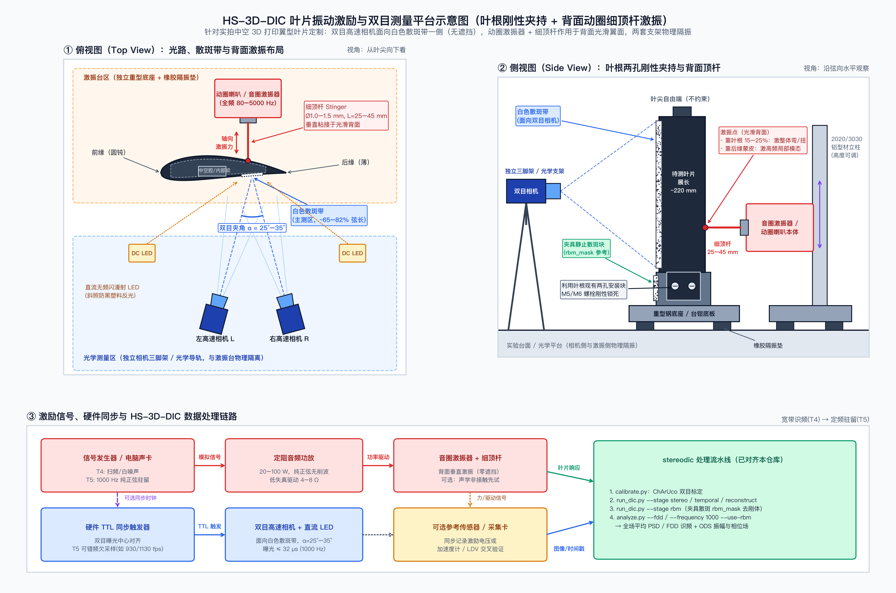

# 高速双目 DIC 叶片振动实验台方案论证与预算申请

> 所属项目：HS-3D-DIC（高速双目数字图像相关叶片三维振动测量）  
> 配套实施文档：[振动实验台设定.md](振动实验台设定.md)  
> 申请目的：说明叶片振动激励平台的选型依据、技术优势与经费预算（**总预算约 ¥350–¥550**），供方案评审与预算审批

---

## 1. 申请摘要

目前项目已完成高速双目 3D-DIC 核心算法与全链路流水线开发（标定、二阶立体匹配、固定参考时序追踪、三维重建、刚体补偿、全场平均 Welch PSD、FDD、ODS 谐波拟合与不确定度分析），并已具备双目高速相机与待测叶片夹持平台。

为开展真实叶片的 **宽带固有频率识别（T4）** 与 **高至 `1000 Hz` 定频驻留振型测量（T5）** 试验验证，拟搭建一套低成本、可控频率与波形的激励施加平台。经多方案技术与经济性对比，选定**“无纸盆全频音圈激振器（Dayton DAEX32EP-4）+ 定阻音频功放 + 金属细顶杆（Stinger）”**方案：

- **技术达标**：平坦覆盖 `100 Hz – 5 kHz`，在 `1000 Hz` 处阻抗平坦（~3.6 Ω）、相位接近 `0°`、10 W 安全功率即可输出约 `9.4 N` 纯正弦激振力，完全满足中空 3D 打印及薄壁金属叶片的宽带扫频与 `1000 Hz` 定频激振需求；
- **成本极低**：复用已有夹持平台与电脑信号输出，整套激励系统总预算仅需 **¥350–¥550**，相比商用模态激振系统（¥15,000–¥50,000+）节省经费 **97% 以上**；
- **周期极短**：全部为标准现货器件，采购 2–3 天到位，1 天内可完成装配联调，立即投入试验验证。

---

## 2. 平台方案与技术优势

### 2.1 平台总体示意图

结合实拍待测叶片（中空 3D 打印翼型，底部自带两孔矩形安装块，较平坦面靠近后缘贴有白色散斑带，背面为光滑黑色凸面）的结构特点，平台采用**“正面双目测量（面向白色散斑带）+ 背面音圈细顶杆激振 + 底部两孔刚性锁死 + 双支架物理隔振”**布局：

### 2.2 核心工程优势

1. **正面光路完全零遮挡，适配双目 DIC 测量**
   - 激振器与细顶杆全部布置在叶片光滑背面，双目相机（会聚夹角 `25°–35°`）与直流漫射 LED 光源面向白色散斑带，无任何遮挡与阴影干扰。
2. **叶根边界清晰，不引入额外质量与刚度失真**
   - 直接利用叶根现有两孔刚性锁死在已有夹持平台上（悬臂边界），激振器外壳固定在独立的铝型材支架上，仅通过一根轻质金属细顶杆（Ø1.2–1.5 mm / M2 细螺杆，长 30–40 mm）垂直接触叶片背面；
   - 细顶杆“轴向刚、弯曲柔”，既高效传递轴向激振力，又避免对叶片施加多余的转动约束，同时避免将百克级激振器直接贴在轻质叶片上造成固有频率漂移。
3. **1000 Hz 高频性能与信噪比定量可靠**
   - 选用的 `Dayton DAEX32EP-4` 音圈激振器实测参数为：额定功率 `40 W`、阻抗 `4 Ω`、磁路力系数 `BL = 4.2 T·m`、音圈电感仅 `0.21 mH @ 1 kHz`、动子质量仅 `5.4 g`；
   - 厂测阻抗/相位曲线与频响曲线显示，`400 Hz – 1.8 kHz` 处于平坦输出平台，**`1000 Hz` 处阻抗约 `3.6 Ω`、电相位接近 `0°`**，波形失真极低；
   - 在仅 `10 W`（额定功率 25%，温升安全）驱动下即可输出约 **`9.4 N`** 峰值正弦力，共振放大后在叶片测区可产生 `20–200 µm` 离面振幅；相对本系统双目 DIC 谐波拟合噪声底（`~0.1–0.3 µm`），测量信噪比可达 **100 以上**。
4. **高频结构耐久性经力学核算满足要求**
   - 以 Ø1.2 mm 弹簧钢丝 / M2 细螺杆（长 `35 mm`）在 `1000 Hz`、`5 N` 交变力下核算：轴向应力仅 `4.4 MPa`（安全系数 > 100）、压杆屈曲临界载荷 > `164 N`（安全系数 > 30）、横向一阶弯曲自振频率约 `4450 Hz`（远高于 `1000 Hz`，无横向甩振风险）；
   - 两端采用大底面法兰螺母 + 刚性环氧胶 + 锁紧背母防松设计，彻底消除高频脱胶与螺纹松动。
5. **信号灵活可控，无缝衔接 `stereodic` 算法链路**
   - 由电脑声卡直接输出 `20–1500 Hz` 扫频/白噪声（支持 T4 全场平均 PSD 与 FDD 识频）或精确 `1000 Hz` 纯正弦驻留（支持 T5 谐波拟合与 ODS 振型提取，且支持欠采样）；
   - 夹持底座贴装静止散斑参考块并物理隔振，可直接对接本仓库 `rbm` 模块评估与扣除底座微弱晃动。

---

## 3. 备选方案横向对比

在确定方案前，对实验室常见的四类振动激励方案从频段能力、波形质量、附加扰动与成本四个维度进行了对比：

| 对比维度 | 商用标准电磁模态激振器 + 功放 | 压电陶瓷片（PZT/MFC）+ 高压驱动 | 普通低音振子（20–200 Hz） | **本方案：无纸盆全频音圈激振器 + 定阻功放 + 细顶杆** |
| --- | --- | --- | --- | --- |
| **预算成本** | **¥15,000 – ¥50,000+** | **¥1,500 – ¥5,000+**（高压放大器较贵） | ¥150 – ¥300 | **¥350 – ¥550（最优）** |
| **1000 Hz 激励能力** | 极佳（5 Hz – 5 kHz） | 优秀（500 Hz – 10 kHz） | **不达标**（>300 Hz 严重衰减） | **优秀（100 Hz – 5 kHz 平坦，1000 Hz 处于黄金段）** |
| **低中频覆盖（40–300 Hz）** | 极佳 | 较弱（对高阻尼 3D 打印厚壁叶片推力不足） | 良好 | **良好（10 W 即可输出 ~9.4 N 推力）** |
| **波形纯度与扫频/定频** | 极佳 | 极佳 | 中等 | **优秀（纯正弦/扫频/白噪声任意切换）** |
| **对叶片质量/刚度干扰** | 极小（细顶杆解耦） | 极小（脆性贴片需防曲面碎裂） | 较大 | **极小（外壳固定外部支架 + 细顶杆解耦）** |
| **采购与搭建周期** | 2–4 周 | 1–2 周 | 2–3 天 | **2–3 天，到手即装** |
| **结论** | 后续正式金属叶片验收按需升级 | 成本偏高且低频推力受限，暂不选用 | 无法满足 1000 Hz 要求，否决 | **当前阶段性价比与工程可行性最优** |

---

## 4. 预算明细表

现有夹持平台、双目高速相机与实验电脑均直接复用，本次申请经费**仅包含激励施加链路及支架配件**：

### 4.1 基础必选清单（推荐立项审批）

| 序号 | 物料名称 | 规格型号 | 数量 | 预计单价（元） | 小计（元） | 用途说明 |
| ---: | --- | --- | ---: | ---: | ---: | --- |
| 1 | 无纸盆音圈激振器 | Dayton DAEX32EP-4（40 W, 4 Ω, 100 Hz–5 kHz） | 1 个（备用可选 +1） | 160 | 160 | 核心高频激振源（若增购 1 个备用则为 320 元） |
| 2 | 成品定阻音频功放 + 24V 电源 | TPA3116D2 / TPA3255 桌面功放套装（50–100 W，含 24 V 5 A 电源） | 1 套 | 130 | 130 | 放大电脑信号驱动 4 Ω 激振器，留足余量防削波 |
| 3 | 细顶杆与防脱胶端头套件 | M2 不锈钢全牙螺杆 + M2 圆底法兰螺母 + M2 薄背母 + Ø8/12 垫片 + 环氧 AB 胶 + 243 螺纹胶 | 1 套 | 40 | 40 | 连接激振器动子盘与叶片背面，防 1000 Hz 脱胶松动 |
| 4 | 激振器可调安装支架 | 2020 铝型材（底座+立柱）+ T 型滑块角码 + L 型固定板 + 橡胶隔振垫 | 1 套 | 80 | 80 | 独立固定激振器外壳，支持展向/弦向无级微调 |
| 5 | 信号与功放连接线材 | 3.5 mm 音频线 + 2 芯 1.0 mm² 喇叭线 + 插簧端子/鳄鱼夹 | 1 套 | 25 | 25 | 连接电脑耳机口 → 功放 → 激振器 |
| | **基础预算合计** | | | | **¥435** | **按浮动区间申请约 ¥400–¥550** |

### 4.2 可选扩展项（按需增补，当前非必需）

| 物料名称 | 规格说明 | 预计费用（元） | 说明 |
| --- | --- | ---: | --- |
| 备用激振器 | Dayton DAEX32EP-4 × 1 | 160 | 防止连续调参过载影响试验进度 |
| 独立 DDS 信号发生器 | 桌面/便携双通道 DDS（精确到 0.01 Hz） | 120 | 前期可用电脑声卡免费替代，后续脱离电脑或做双路同步时再购 |

---

## 5. 预期试验产出与后续可扩展性

本预算落地后，预计 **1 周内**可完成整套平台的装配、联调与首轮实测验证，产出以下关键成果：

1. **实测静态噪声底（E1）**：评估双目系统在当前照明与夹持环境下的三维位移噪声底及噪声频谱；
2. **宽带模态频率识别（T4）**：通过扫频/随机激励，完成 `stereodic` 流水线全场平均 Welch PSD 与 FDD 识频验证；
3. **1000 Hz 定频全场三维振型（T5）**：获得待测叶片在目标频率下的全场三维振幅、相位与 ODS 振型分布；
4. **无缝面向后续升级**：本平台定义的夹持基准、同步触发架构及 `stereodic` 数据处理流水线完全通用；后续若开展更高载荷或正式航空金属叶片试验，仅需将背面音圈激振器替换为商用电磁激振器，其余光学与软件体系零改动复用。
