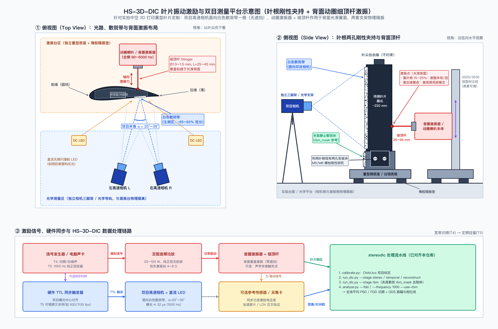

# 振动实验台设定方案（动圈激振器 + 细顶杆）

> 适用项目：HS-3D-DIC / `stereodic`（高速双目 DIC 叶片三维振动测量）  
> 关联文档：[StereoDIC_Technical_Design.md](StereoDIC_Technical_Design.md)  
> 方案定位：低成本、可覆至 `1000 Hz` 的可控激振实验台——叶根两孔刚性悬臂夹持 + 背面全频动圈喇叭/音圈激振器 + 金属细顶杆（Stinger） + 正面双目高速 DIC 测量

---

## 1. 总体布局与平台示意图

针对实拍的黑色中空 3D 打印翼型叶片（弦长与展长约 `200–240 mm`，底部自带两孔矩形安装块，较平坦面靠近后缘 `65%–82%` 弦长处贴有白色散斑带，另一侧为光滑黑色凸面），平台采用**“底部刚性锁死 + 正面无遮挡双目测量 + 背面动圈细顶杆激振 + 两套支架物理隔振”**架构：



核心布局原则：

1. **边界唯一**：叶根利用现有两孔刚性锁死在重型底座上，叶尖完全自由，确保测得的是纯粹的叶片弹性振动；
2. **正面无遮挡**：双目相机与照明全部面向白色散斑带一侧；
3. **背面施加激振**：动圈激振器与细顶杆布置在光滑黑色背面，完全不遮挡相机视野；
4. **光学与激振隔振**：双目相机架设在独立三脚架或光学导轨上，与激振底座物理分离，并在夹具上增设静止散斑块用于 `rbm_mask` 监控与补偿。

---

## 2. 硬件选型与低成本物料清单（BOM）

整套激振与夹持平台（不含双目相机及已有光学支架）预算可控制在 **¥300–¥800** 左右：

| 序号 | 部件名称 | 推荐规格 / 选型要点 | 数量 | 参考单价 | 关键避坑说明 |
| ---: | --- | --- | ---: | ---: | --- |
| 1 | **激振驱动源** | **首选**：无纸盆音圈激振器（如 Dayton DAEX25/DAEX32 系列，20–40 W，4/8 Ω，100 Hz–10 kHz）<br>**备选**：3–5 寸**全频/中音**动圈喇叭（30–80 W，4/8 Ω，80–5000 Hz） | 1 | ¥80–200 | **严禁买纯低音振子/沙发震动器**（200–300 Hz 以上衰减严重，推不动 1000 Hz） |
| 2 | **定阻音频功放** | 50–100 W 单/双声道数字或模拟定阻功放（如 TPA3116/TPA3255 成品板或桌面功放），配对应 24 V 直流电源 | 1 | ¥80–180 | 需留足功率余量，避免满载削波产生高次谐波失真 |
| 3 | **信号源** | 电脑声卡（3.5 mm 转 RCA 线，用 Python / Audacity / REW 输出扫频、白噪声或精准单频正弦）或手持 DDS 信号发生器 | 1 | ¥0–150 | 电脑声卡即可满足 20 Hz–20 kHz；DDS 信号发生器频率精度与调频更方便 |
| 4 | **细顶杆（Stinger）** | **Ø1.2–1.5 mm 弹簧钢丝**（65Mn 钢琴钢丝 / 硬态 304 不锈钢丝）或 **M1.6 全牙不锈钢细螺杆**，截取 **25–45 mm** | 若干 | ¥10–20 | 优先选金属钢丝/细螺杆，**慎选纯碳纤维细杆**（端头高频交变易劈裂） |
| 5 | **顶杆端头法兰片** | Ø6–8 mm、厚 1–2 mm 轻质金属平垫片或 M2 薄螺母 + **刚性环氧 AB 结构胶**（如 5 分钟快干环氧） | 1 套 | ¥20–30 | **绝对不要直接把钢丝端面用 502 点粘在叶片上**，必须靠垫片扩大粘接面积防脱胶 |
| 6 | **可调激振支架** | **2020 或 3030 铝型材**（底框 + 400 mm 立柱）+ T 型螺母滑块 + L 型固定角码 | 1 套 | ¥60–120 | 允许沿展向（上下）和弦向（左右）无级调整激振点，并微调顶杆轴线垂直度 |
| 7 | **叶根刚性夹具** | 刚性 L 型钢块/厚铝块（按叶根两孔孔距钻通孔）+ M5/M6 螺栓垫片 + 重型钢底板（或重型平口台钳）+ 橡胶隔振垫 | 1 套 | ¥50–150 | 夹持块与底板质量越大越好（建议 ≥ 3–5 kg），降低底座随叶片反振的幅度 |
| 8 | **直流漫射照明** | 2 盏高亮**直流供电无频闪**摄影 LED 补光灯 + 柔光纸（可选偏振片） | 2 | 按已有配置 | 严禁使用普通交流灯具（会产生 50/100 Hz 频闪假谱峰） |

---

## 3. 核心机械制作与装配细节

### 3.1 叶根两孔刚性夹持与静止参考块

1. **利用原装两孔锁死**：按实拍叶片底部矩形安装块的孔距与孔径，在 L 型钢夹块上打两个同轴定位孔，将叶片安装块紧贴夹块侧面，用两颗螺栓加平垫/弹垫均匀锁紧；将夹块牢固固定在重型钢底板或台钳上，底板下方垫橡胶隔振垫。
2. **叶尖不约束**：叶尖顶部伸出的小榫头保持完全悬空自由，不施加任何支撑。
3. **贴装 `rbm_mask` 静止参考散斑**：在夹块朝向相机一侧的平坦面上贴一小块哑光白底黑点散斑（约 `25 × 25 mm`），确保同时落在双目共同视野内，后续在实验 YAML 中配置 `rbm_mask` 即可自动监测并扣除底座微弱晃动。

### 3.2 动圈激振器与细顶杆装配（关键避坑）

#### （1）激振器端连接（严禁粘在软纸盆上）
- **若使用无纸盆音圈激振器（推荐）**：其中心本身就是刚性驱动盘，先将驱动盘表面轻微打磨并用酒精脱脂，居中粘接端头垫片/螺母法兰即可。
- **若使用普通全频动圈喇叭**：
  1. 用美工刀沿边缘小心割除正中心的**防尘帽**，露出内部的圆形**音圈骨架**；
  2. 保留底部的黄色波纹**弹波（Spider）**和外围折环——它们是天然的无间隙轴向直线导向机构；
  3. 剪一片与音圈骨架直径匹配的轻质刚性圆片（1 mm 铝片或玻纤板），用环氧 AB 胶**同轴粘在音圈骨架端面上**（绝不依赖软纸盆传力，彻底规避 800–2000 Hz 纸盆分割共振）。

#### （2）细顶杆（Stinger）尺寸核算与防脱胶装配
取 **Ø1.2 mm 弹簧钢丝、自由段长度 `35 mm`**，在 `1000 Hz`、峰值激振力 `5 N` 下的力学裕度如下：

| 校核项 | 计算结果 | 工程安全裕度 |
| --- | --- | --- |
| 轴向交变应力 | $\sigma = 4.4\text{ MPa}$（钢丝疲劳极限 500–800 MPa） | **> 100 倍**，不会疲劳断裂 |
| 欧拉压杆屈曲载荷 | 固支约 `657 N`（铰支约 `164 N`） | **> 30 倍**，不会压弯失稳 |
| 横向一阶弯曲共振 | $f_{1,\text{bend}} \approx 4450\text{ Hz}$ | **> 4 倍于 1000 Hz**，不会横向甩振 |

**两端防脱胶装配工艺（头号关键点）**：
1. 顶杆两端各套一个 **Ø6–8 mm 金属垫片（或 M2 薄螺母）**，将钢丝穿入孔内折小弯头或配合 M1.6 细螺杆直接旋入螺母，用少量环氧 AB 胶在背面灌牢，形成 T 型法兰端头（将粘接面积从 `~1 mm²` 扩大到 `30–50 mm²`）；
2. 将铝型材立柱移至叶片光滑背面，调节滑块高度与前后距离，确保顶杆**严格垂直于局部背面翼面**且**无初始弯曲预应力**；
3. 先将叶片端法兰垫片用薄层环氧 AB 胶粘在背面目标激振点（可用美纹纸临时定位固化 15–30 分钟），再微调激振器使音圈处于**自然中立位置（不拉不压）**后锁紧立柱滑块，最后固连音圈端。

> **小技巧（可拆换设计）**：若需要更换多个激振点，可在叶片背面目标位置粘一枚 M2 超薄螺母（仅 ~0.2 g），细顶杆采用 **M1.6/M2 细全牙螺杆**旋入并用锁紧螺母轻轻背紧，即可快速拆装更换激振点而不损伤叶片表面。

### 3.3 背面激振点布置策略

由于待测叶片为中空 3D 打印塑料（材料阻尼高于金属，前缘截面较厚，后缘蒙皮较薄），建议按目标频段移动铝型材滑块：

1. **低中频整体弯曲 / 扭转模态（约 40–300 Hz）**：激振点放在**靠叶根 15%–25% 展高、靠近内部纵梁**处；尽量避开弦向中线（稍微偏置），可同时激起弯曲与扭转模态；
2. **高频模态与后缘局部模态（300–1000+ Hz）**：将滑块上移，激振点放在**白色散斑带正后方附近的光滑背面薄壁区域**，使 1000 Hz 激振能量直接作用于低刚度蒙皮，凭借共振放大在测区获得 **20–200 µm** 清晰振幅；
3. **无接触预扫频技巧**：粘接顶杆前，可先把喇叭正对光滑背面 1–2 cm 处播放扫频纯音（听声音共振突变或配合手机/简易加速度计），快速摸出叶片大致的共振频率区间，再决定顶杆高度与最终粘接位置。

---

## 4. 激励信号链路与运行安全规范

### 4.1 信号与功放接线

```text
[电脑声卡 / DDS 信号发生器]
        │  纯正弦(T5) 或 扫频/白噪声(T4)
        ▼
[定阻音频功放 (4–8 Ω, 20–100 W)] ──(可选: 10:1 分压电阻)──▶ [同步采集卡 (记录激励参考信号)]
        │  功率输出
        ▼
[背面动圈激振器] ──▶ [细顶杆 Stinger] ──▶ [叶片光滑背面]
```

- **T4 宽带识频信号**：使用 `20 Hz – 1500 Hz` 线性/对数扫频（持续 3–10 s）或带限白噪声，先定位各阶共振峰；
- **T5 定频驻留信号**：锁定 T4 测得的共振频率（或目标 `1000 Hz`），输出高纯度单频正弦波；
- **避免削波**：功放旋钮开至 50%–70% 以下，通过信号源幅值精细调节激励大小；若听到明显高频杂音/破音，说明功放削波或顶杆松动，应立即调低输入幅值。

### 4.2 防音圈过热节奏

全频喇叭/音圈激振器在 1000 Hz 纯正弦连续满功率下容易发热，而高速双目 DIC 单次采集只需 **1–3 秒**（1000 fps 下 2 秒即可采满 2000 帧）。建议严格采用**短时驻留节奏**：

1. **小功率（10%–20%）**缓慢调频，用肉眼/声音/参考传感器确认达到共振峰值；
2. 调至**目标工作功率**，稳定 **1–2 秒** 消除瞬态响应；
3. 触发双目高速相机采集 **1–3 秒**；
4. 采集完成立即将功放归零或静音，间隔冷却 10–30 秒再测下一频点。

---

## 5. 双目光学、照明与采样参数设定

### 5.1 双目布置与防反光照明

- **双目夹角**：两台同型号全局快门黑白高速相机架在**独立三脚架或光学导轨**上，对称会聚对准白色散斑带，夹角取 **$\alpha = 25^\circ\text{–}35^\circ$**。
- **防反光布灯**：实拍中白色散斑带周围的黑色 3D 打印表面及局部胶痕有较强镜面反光。两盏**直流无频闪 LED** 须布置在相机左右外侧约 **45° 斜照**并加柔光漫射片；若仍有反光高亮点，可在灯前和镜头前加正交偏振片。
- **硬件同步**：使用硬件 TTL 触发器同步双目曝光中心，并用 `scripts/check_sync.py` 校验时间戳同步偏差。

### 5.2 采样帧率与 1000 Hz 欠采样配置

按 [技术设计 §3.2 & §11.3](StereoDIC_Technical_Design.md)：

| 测量任务 | 目标频率 | 推荐相机帧率 $f_s$ | 说明 |
| --- | --- | --- | --- |
| **T4 宽带识频**（扫频/随机） | 覆盖至 `1000 Hz` | **$\ge 2500\text{–}3000\text{ fps}$** | 满足 $f_s \ge 2.5 f_{\max}$，无混叠直接做 `field_average_psd` 与 `fdd` |
| **T5 定频驻留**（高频相机） | `1000 Hz` | **$\ge 2500\text{–}5000\text{ fps}$** | 直接看清时域波形并用 `harmonic.py` 拟合 |
| **T5 定频驻留**（受限于 ~1000 fps 相机） | `1000 Hz` | **错频设 `930 fps` 或 `1130 fps`** | **严禁恰好设成 `1000.0 fps`**（否则 1000 Hz 会混叠成 0 Hz 直流）；错开后由信号源提供精确频率，本仓库 `harmonic.py` / `ods.py` 可直接精确恢复振幅与相位 |

### 5.3 曝光时间核算

按 $t_{\text{exp}} \lesssim \dfrac{\delta\, s}{2\pi f A}$（取物方比例 $s = 0.1\text{ mm/px}$、允许运动模糊 $\delta = 0.1\text{ px}$）：

| 工况 | 频率 $f$ | 预估振幅 $A$ | 曝光时间上限 $t_{\text{exp}}$ |
| --- | ---: | ---: | ---: |
| 低阶弯曲模态 | 150 Hz | 0.50 mm | $\le 21\,\mu\text{s}$ |
| 1000 Hz 定频驻留（常规） | 1000 Hz | 0.05 mm | $\le 32\,\mu\text{s}$ |
| 1000 Hz 定频驻留（小幅） | 1000 Hz | 0.02 mm | $\le 80\,\mu\text{s}$ |

> 在 $s = 0.1\text{ mm/px}$、$\alpha = 30^\circ$、$\sigma_p = 0.01\text{ px}$ 下，单帧离面噪声约 `2.7 µm`；采集 `1000` 帧做谐波拟合后振幅噪声底可降至 `~0.1–0.3 µm`，可稳定分辨 `10–20 µm` 以上的 1000 Hz 振动。

---

## 6. 上机调试流程与故障排查

### 6.1 标准试验流程（对接 `stereodic`）

1. **T0 光学与同步核验**：调焦并确认白色散斑带成像颗粒直径在 3–5 px、灰度直方图无过曝饱和；运行 `scripts/check_sync.py` 核对双目同步。
2. **T1 双目标定**：采集 20–40 个不同位姿的 ChArUco 标定板图像，运行 `scripts/calibrate.py`，检查重投影残差图后锁定镜头不再触碰。
3. **T2 静态噪声底（E1）**：功放断电，以与正式试验**完全相同的帧率、曝光和照明**采集静止叶片（约 200–500 帧），走一遍 `stereo → temporal → reconstruct`，确认静态噪声底和频谱中无照明频闪或环境干扰峰。
4. **T4 宽带扫频识频**：播放扫频或白噪声激励，运行完整流水线提取各阶共振频率：
   ```bash
   uv run python scripts/run_dic.py --config configs/experiments/<name>.yaml --stage stereo -v
   uv run python scripts/run_dic.py --config configs/experiments/<name>.yaml --stage temporal -v
   uv run python scripts/run_dic.py --config configs/experiments/<name>.yaml --stage reconstruct -v
   uv run python scripts/run_dic.py --config configs/experiments/<name>.yaml --stage rbm -v
   uv run python scripts/analyze.py --config configs/experiments/<name>.yaml --direction 2 --use-rbm --fdd
   ```
5. **T5 定频驻留测振型**：在 T4 找出的目标频率（如 `1000 Hz`）上正弦驻留采集，输出全场振幅、相位与 ODS：
   ```bash
   uv run python scripts/analyze.py --config configs/experiments/<name>.yaml \
     --direction 2 --use-rbm --frequency 1000
   ```
6. **可选交叉验证（T6）**：如有同步记录的激励信号或加速度计/LDV 数据，传入 `--force-file` 输出 $H_1$ FRF 与相干函数，核验频响与振幅精度。

### 6.2 常见故障快速排查

| 现象 | 常见原因 | 解决方法 |
| --- | --- | --- |
| 1000 Hz 振幅极小（接近噪声底） | 激励频率未落在叶片共振峰上；或误买了低音振子；或顶杆顶在厚叶根纵梁处 | 先在 800–1200 Hz 附近精细扫频寻找局部共振峰；核实为全频喇叭/音圈激振器；将顶杆移至白色散斑带正后方薄壁蒙皮处 |
| 运行几秒后出现高频“咔哒”异响 | 顶杆端头脱胶松动，或音圈触底打底 | 改用 Ø6–8 mm 法兰垫片 + 环氧 AB 胶增大粘接面积；装配时确保音圈处于自然中立位；降低功放增益 |
| 频谱出现大量 2 倍频、3 倍频杂峰 | 功放削波失真，或顶杆过长发生横向弯曲振动 | 调低信号源与功放增益；将顶杆缩短至 25–40 mm（Ø1.2–1.5 mm 钢丝） |
| 静止参考块（夹具）测到明显同频振动 | 激振底座反振传导至相机三脚架，或底座太轻 | 增加夹持底板配重与橡胶隔振垫；将相机三脚架与激振台物理分开；在 `analyze.py` 中启用 `--use-rbm` |
| 散斑带局部出现 `HIGH_RESIDUAL` 或失配 | 黑色塑料边缘反光溢出，或曝光过长导致运动模糊 | 调整直流 LED 至 45° 斜照加漫射/偏振片；按第 5.3 节缩短曝光并补足直流光强 |
